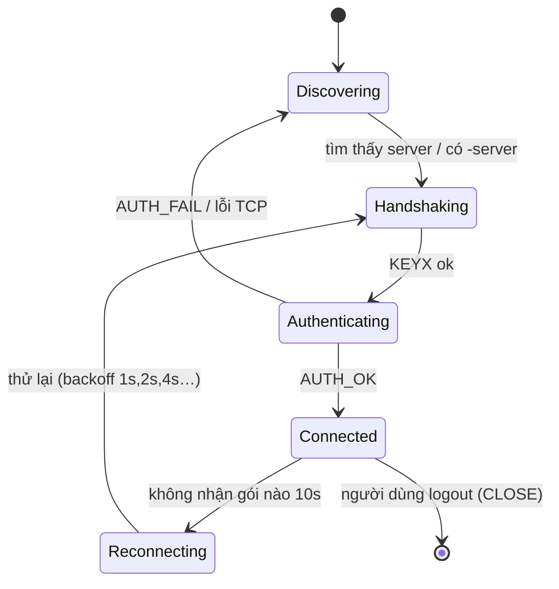
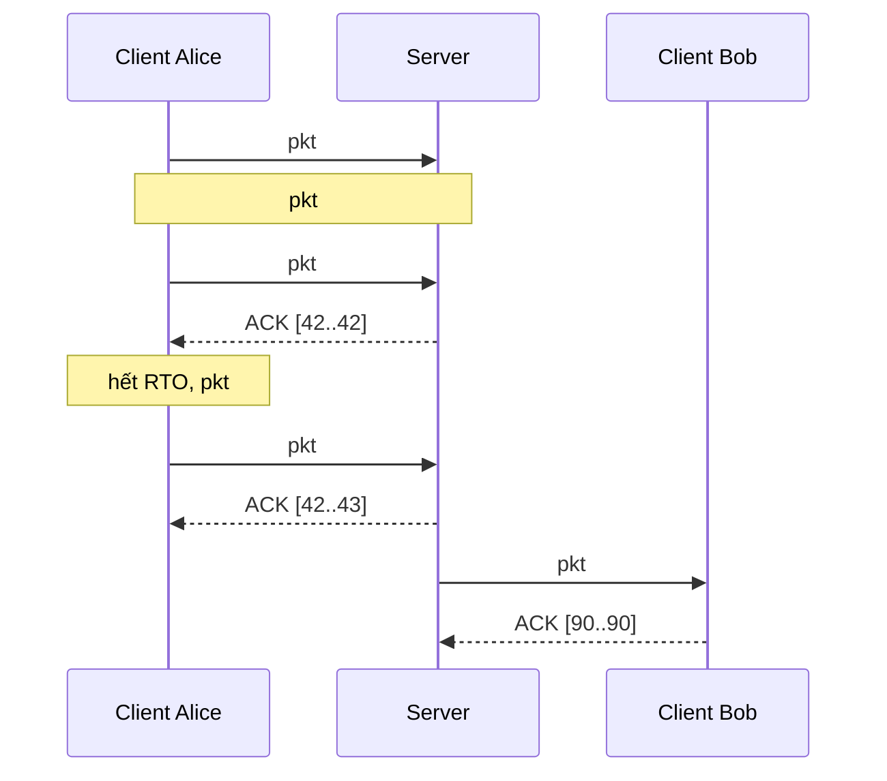

# Kế hoạch BTL1 — Distributed Streaming-based Client-Server Collaboration App (Go)

> Nhóm 2 người: **A** = ____________  **B** = ____________
> Hôm nay: **Thứ Hai 02/11/2026**. Đề ghi "Sunday, November 17" nhưng 17/11 là **thứ Ba**, nên hỏi lại giảng viên.
> **Mục tiêu nội bộ: xong toàn bộ trước Chủ nhật 15/11**, còn 16–17/11 làm buffer.

---

## Mục lục

0. [Ý tưởng tổng thể & chia vai](#0-ý-tưởng-tổng-thể--chia-vai)
1. [Go cấp tốc — những gì thật sự cần cho bài này](#1-go-cấp-tốc)
2. [Cấu trúc project & quy ước làm việc nhóm](#2-cấu-trúc-project--quy-ước-làm-việc-nhóm)
3. [Đặc tả giao thức (bản chốt chung)](#3-đặc-tả-giao-thức)
4. [Phase 0 (02–03/11) — Setup, học Go, Step 1](#phase-0--0203-11--setup-học-go-step-1)
5. [Phase 1 (04–06/11) — Handshake TCP, Auth, đóng gói packet](#phase-1--0406-11--handshake-tcp-auth-đóng-gói-packet)
6. [Phase 2 (07–10/11) — Reliable UDP + routing + concurrency](#phase-2--0710-11--reliable-udp--routing--concurrency)
7. [Phase 3 (11–12/11) — Gửi file, mã hóa, resilience](#phase-3--1112-11--gửi-file-mã-hóa-resilience)
8. [Phase 4 (13–14/11) — CUBIC + Web UI](#phase-4--1314-11--cubic--web-ui)
9. [Phase 5 (15–17/11) — Test, README, báo cáo](#phase-5--1517-11--test-readme-báo-cáo)
10. [Lỗi Go hay gặp & cách debug](#10-lỗi-go-hay-gặp--cách-debug)
11. [Checklist nộp bài cuối cùng](#11-checklist-nộp-bài)

---

## 0. Ý tưởng tổng thể & chia vai

### Hệ thống gồm những gì

```
┌──────────────── CLIENT (mỗi user 1 process) ─────────────────┐      ┌──────────────── SERVER ──────────────────┐
│ Trình duyệt (HTML + JS thuần)                                │      │ TCP :9000  Handshake + trao khóa + Auth  │
│     │  fetch() polling                                       │      │ UDP :9001  1 socket chung cho mọi client │
│ webui: HTTP server TỰ VIẾT bằng raw TCP (localhost:8080)     │      │   demux theo conn_id → transport.Conn    │
│     │                                                        │      │ Registry: user, IP, port, lastSeen       │
│ client core: xử lý message/file, EventLog                    │      │ Router: broadcast / DM / relay file      │
│     │                                                        │      │ Discovery: broadcast UDP :9002 mỗi 2s    │
│ transport: reliable UDP (stream, ACK/SACK, window, CUBIC,    │◄────►│ Timeout: conn chết → xóa user, báo leave │
│            AES-GCM)                                          │ UDP  │                                          │
└──────────────────────────────────────────────────────────────┘      └──────────────────────────────────────────┘
```

**Luồng chính:**
1. Client nghe broadcast UDP :9002 để tìm server, hoặc nhập IP qua cờ `-server`.
2. Client mở TCP :9000, trao khóa ECDH (X25519), gửi username/password **đã mã hóa**. Server trả `conn_id`, sau đó đóng TCP.
3. Từ đây **mọi thứ đi qua UDP :9001**, trên giao thức tin cậy tự viết. Mỗi tin chat là 1 stream ngắn, mỗi file là 1 stream riêng. Gói của stream file bị mất **không chặn** tin chat, tức là không có Head-of-Line blocking.

### Chia vai (theo package, để hạn chế conflict git)

| | **A — Transport & Security** | **B — Application, Server & UI** |
|---|---|---|
| Package sở hữu | `internal/protocol`, `internal/transport` | `internal/server`, `internal/client`, `internal/webui`, `cmd/*` |
| Phụ trách các Step | 1 (phần packet), 5 (lõi), 6 (lõi stream), 8, CUBIC, một phần 10 | 1 (state diagram), 2, 3, 4, 5 (routing), 6 (tầng app), 7, 9, 10 |
| Viết trong báo cáo | Protocol Specification; Challenges phần transport | System Architecture; Sequence Diagrams; README |
| Cùng làm | Phase 0 (spec), review PR của nhau, test tích hợp Phase 5 | |

> ⚠️ Khi vấn đáp, giảng viên có thể hỏi **bất kỳ ai về bất kỳ phần nào**. Vì vậy **bắt buộc review PR của nhau** và đọc hiểu code của người kia. Cách tốt nhất là tối nào cũng giải thích code cho nhau 15 phút.

### "Hợp đồng" giữa A và B (chốt ngày 03/11)

B không cần đợi A làm xong transport mới bắt đầu: B code dựa trên **interface**, và dùng **bản giả (fake)** để test trước.

```go
// internal/transport/api.go  — A sở hữu, B chỉ dùng
package transport

// Delivery là 1 đoạn byte ĐÃ ĐÚNG THỨ TỰ trong 1 stream.
type Delivery struct {
	StreamID uint32
	Data     []byte
	Fin      bool // true = stream kết thúc
}

type Stats struct {
	RTT        time.Duration
	Cwnd       int // byte
	InFlight   int
	LostPkts   uint64
	SentPkts   uint64
	State      string // "connected", "closed", ...
}

// Endpoint là những gì tầng app cần từ transport.
type Endpoint interface {
	SendMessage(b []byte) error                // 1 message = 1 stream ưu tiên cao
	OpenStream(urgent bool) io.WriteCloser     // stream dài (file), Close() = gửi FIN
	Recv() <-chan Delivery                     // dữ liệu nhận được
	Done() <-chan struct{}                     // đóng khi kết nối chết/timeout
	Stats() Stats
	Close() error
}
```

---

## 1. Go cấp tốc

> Lộ trình học: tối 02/11 làm [A Tour of Go](https://go.dev/tour) (phần Basics + Methods/Interfaces + Concurrency, khoảng 3–4 giờ), sau đó tra [Go by Example](https://gobyexample.com) khi cần. Không cần học hết, phần dưới đây là đủ cho bài này.

### 1.1 Cài đặt (macOS)

```bash
brew install go            # cài Go
go version                 # nên ≥ 1.22
# VS Code: cài extension "Go" (của Go Team at Google), nó sẽ hỏi cài gopls, dlv... → Install All
```

Các lệnh dùng hằng ngày:

| Lệnh | Tác dụng |
|---|---|
| `go mod init github.com/<user>/go-collab` | Tạo module (1 lần duy nhất) |
| `go run ./cmd/server` | Biên dịch và chạy |
| `go build -o bin/server ./cmd/server` | Build ra file chạy |
| `go test ./...` | Chạy mọi test |
| `go test -race ./...` | Chạy test **có dò data race**, rất quan trọng với bài này |
| `go vet ./...` | Bắt lỗi thường gặp |
| `gofmt -w .` | Format code (VS Code tự làm khi save) |
| `GOOS=windows GOARCH=amd64 go build ...` | Build cho Windows ngay trên Mac |

### 1.2 Cú pháp cơ bản

```go
package main // file chạy được phải là package main và có func main

import (
	"fmt"
	"log"
)

const MaxPacket = 1200 // hằng số

type User struct { // struct ~ class không có kế thừa
	Name string
	Port int
}

// Method: (u *User) là "receiver". Dùng con trỏ * khi cần sửa struct.
func (u *User) Rename(n string) { u.Name = n }

// Hàm trả về nhiều giá trị; lỗi luôn là giá trị trả về CUỐI CÙNG
func divide(a, b int) (int, error) {
	if b == 0 {
		return 0, fmt.Errorf("chia cho 0: a=%d", a)
	}
	return a / b, nil
}

func main() {
	u := &User{Name: "phong", Port: 9000} // := khai báo + gán, tự suy kiểu
	u.Rename("hai")

	q, err := divide(10, 0)
	if err != nil { // Go KHÔNG có try/catch → luôn kiểm tra err
		log.Println("lỗi:", err)
	}
	fmt.Println(q)

	nums := []int{1, 2, 3}     // slice (mảng động)
	nums = append(nums, 4)
	for i, v := range nums {   // vòng lặp duy nhất của Go là for
		fmt.Println(i, v)
	}

	m := map[string]int{}      // map PHẢI khởi tạo trước khi ghi (map nil ghi vào sẽ panic)
	m["a"] = 1
	if v, ok := m["b"]; !ok {  // kiểm tra key có tồn tại
		fmt.Println("không có b", v)
	}
	delete(m, "a")

	defer fmt.Println("in ra khi main kết thúc") // defer: chạy khi hàm return (dùng để Close)
}
```

> **Viết hoa = public, viết thường = private** (theo package). Ví dụ `transport.Conn` dùng được từ package khác, còn `transport.conn` thì không.

### 1.3 Interface: "duck typing" kiểu Go

```go
// io.Writer chỉ là: type Writer interface { Write(p []byte) (n int, err error) }
// Struct nào có method Write đúng chữ ký thì TỰ ĐỘNG là io.Writer, không cần "implements".

type SendStream struct{ /* ... */ }
func (s *SendStream) Write(p []byte) (int, error) { /* cắt thành frame */ return len(p), nil }
func (s *SendStream) Close() error                { /* gửi FIN */ return nil }

// Nhờ đó gửi file chỉ cần 1 dòng:
//   io.Copy(stream, file)   // file là *os.File (io.Reader), stream là io.Writer
```

Type switch được dùng nhiều khi parse frame:

```go
type Frame interface{ isFrame() }
func (*StreamFrame) isFrame() {}
func (*AckFrame) isFrame()    {}

for _, f := range frames {
	switch f := f.(type) {   // f mang đúng kiểu cụ thể trong từng case
	case *StreamFrame:
		handleStream(f)
	case *AckFrame:
		handleAck(f)
	}
}
```

### 1.4 Concurrency: goroutine, channel, select, mutex (cốt lõi của bài)

```go
go handleClient(conn) // chạy song song, rất nhẹ (vài KB), tạo hàng nghìn goroutine vẫn ổn

ch := make(chan []byte, 64) // channel có buffer 64 phần tử
ch <- data                  // gửi (block nếu buffer đầy)
d := <-ch                   // nhận (block nếu rỗng)
close(ch)                   // báo "hết dữ liệu"; for x := range ch sẽ thoát

// select: chờ nhiều sự kiện cùng lúc, đây chính là "event loop" của transport
ticker := time.NewTicker(10 * time.Millisecond)
defer ticker.Stop()
for {
	select {
	case pkt := <-incoming:
		handle(pkt)
	case <-ticker.C:
		checkTimeouts()
	case <-done:
		return
	}
}
```

**Nguyên tắc vàng của Go:** *"Don't communicate by sharing memory; share memory by communicating."*
→ Mỗi `transport.Conn` có **đúng 1 goroutine `run()` sở hữu toàn bộ state** (bảng gói chưa ACK, cwnd, các stream...). Goroutine khác chỉ **gửi yêu cầu qua channel**, nên phần lõi khó nhất **không cần mutex**.

Khi nhiều goroutine cùng đọc/ghi một map (ví dụ registry user trên server), dùng mutex:

```go
type Registry struct {
	mu     sync.RWMutex
	byName map[string]*Session
}
func (r *Registry) Get(name string) *Session {
	r.mu.RLock()         // nhiều người đọc cùng lúc được
	defer r.mu.RUnlock()
	return r.byName[name]
}
func (r *Registry) Add(s *Session) {
	r.mu.Lock()          // ghi thì độc quyền
	defer r.mu.Unlock()
	r.byName[s.Username] = s
}
```

Mẹo "nil channel": đọc từ channel `nil` sẽ block mãi mãi, nên có thể dùng để **tạm tắt một case** trong `select` (áp dụng ở Phase 2 cho backpressure).

### 1.5 Thư viện chuẩn sẽ dùng (đều hợp lệ vì là socket thô hoặc crypto)

| Việc | Package |
|---|---|
| Socket TCP/UDP | `net` (`net.Listen`, `net.Dial`, `net.ListenUDP`, `ReadFromUDP`, `WriteToUDP`) |
| Đóng gói nhị phân | `encoding/binary` (`BigEndian.PutUint32`, `AppendUint32`...) |
| JSON | `encoding/json` + struct tag `json:"name"` |
| Mã hóa | `crypto/aes`, `crypto/cipher` (GCM), `crypto/ecdh` (X25519), `crypto/sha256`, `crypto/rand` |
| Thời gian | `time` (`Duration`, `Ticker`, `Timer`) |
| Đồng bộ | `sync` (`Mutex`, `WaitGroup`), `sync/atomic` |
| Nhúng file HTML vào binary | `embed` |
| Đọc cờ dòng lệnh | `flag` |
| Test | `testing` |

> 🚫 **Không dùng** `net/http`, `http.server`, gorilla/websocket hay bất kỳ HTTP framework nào. HTTP cho UI phải tự viết trên `net` (Phase 4).

---

## 2. Cấu trúc project & quy ước làm việc nhóm

```
go-collab/
├── go.mod
├── cmd/
│   ├── server/main.go          (B) đọc flag, khởi động server
│   └── client/main.go          (B) đọc flag, khởi động client + web UI
├── internal/
│   ├── protocol/               (A) header, frame, app message (thuần encode/decode, không I/O)
│   │   ├── packet.go
│   │   ├── frame.go
│   │   ├── appmsg.go           (B viết struct JSON, A review)
│   │   └── *_test.go
│   ├── transport/              (A) reliable UDP
│   │   ├── api.go              interface Endpoint, Delivery, Stats
│   │   ├── conn.go             goroutine run(), gửi/nhận
│   │   ├── stream.go           SendStream, recvStream (ghép lại thứ tự)
│   │   ├── ack.go              ackTracker (SACK)
│   │   ├── rtt.go              ước lượng RTT/RTO
│   │   ├── cubic.go            congestion control
│   │   ├── crypto.go           AES-GCM, ECDH
│   │   ├── lossy.go            giả lập mất gói/trễ để test
│   │   ├── fake.go             (B viết) Endpoint giả để test sớm
│   │   └── *_test.go
│   ├── server/                 (B) auth.go, registry.go, router.go, discovery.go, udpmux.go
│   ├── client/                 (B) core.go, events.go, files.go
│   └── webui/                  (B) httpserver.go, api.go, static/{index.html, app.js, style.css}
├── scripts/run_clients.sh      (B) mở N client để test tải
├── docs/
│   ├── protocol.md             (A) đặc tả giao thức
│   └── diagrams/               (B) kiến trúc, sequence, state (Mermaid/draw.io)
├── users.json                  tài khoản demo
└── README.md
```

> Thư mục `internal/` là quy ước của Go: code trong đó chỉ import được từ chính module này.

**Git:**
- Repo GitHub **private**, add giảng viên khi nộp nếu nộp bằng link.
- Nhánh `main` luôn build được. Mỗi việc làm trên nhánh riêng (`a/ack-tracker`, `b/auth`), xong thì mở PR, **người kia review rồi mới merge**.
- Commit nhỏ, message rõ ràng: `transport: add selective retransmission`.
- Trước khi push phải chạy: `gofmt -w . && go vet ./... && go test -race ./...`

**Sync:** họp nhanh 10 phút mỗi tối với 3 câu: hôm nay xong gì, mai làm gì, đang kẹt gì.

---

## 3. Đặc tả giao thức

> Đây là nội dung của **Step 1**. A viết `docs/protocol.md` dựa trên bản này, B vẽ state diagram. Có thể sửa, nhưng **phải thống nhất trước khi code**.

### 3.1 Cổng

| Cổng | Giao thức | Mục đích |
|---|---|---|
| 9000 | TCP | Handshake, trao khóa, đăng nhập (đóng sau khi xong) |
| 9001 | UDP | Toàn bộ dữ liệu: message, file, ACK, heartbeat |
| 9002 | UDP broadcast | Server quảng bá `"COLLAB_SERVER <ip> 9000 9001"` mỗi 2s |
| 8080+ | TCP (HTTP tự viết) | Web UI của từng client, chỉ bind `127.0.0.1` |

### 3.2 Handshake TCP (mỗi message: `[4 byte độ dài][JSON]`)

```
Client                                            Server
  │── HELLO {client_pub}                     ──────►│  sinh khóa X25519, conn_id
  │◄────── KEYX {server_pub, conn_id, udp_port} ────│
  │   cả hai: shared = ECDH; k_tcp = SHA256(shared‖"tcp"); k_udp = SHA256(shared‖"udp")
  │── AUTH {nonce, sealed(AES-GCM,k_tcp, {user,pass})} ►│  kiểm tra users.json
  │◄────── AUTH_OK {users:[...]}  hoặc AUTH_FAIL{reason}│  tạo transport.Conn(conn_id, k_udp)
  │   đóng TCP                                       │
  │══ UDP: gói đầu tiên (PING) mang conn_id ════════►│  server ghi lại IP:port UDP của client
```

### 3.3 Gói UDP

```
 0      2   3   4          8          12                               ≤1200
 ┌──────┬───┬───┬──────────┬──────────┬─────────────────────────────────┐
 │magic │ver│flg│ conn_id  │packet_num│ AES-GCM( frames ) + tag 16 byte │
 │0xC0DE│ 1 │   │ uint32   │ uint32   │                                 │
 └──────┴───┴───┴──────────┴──────────┴─────────────────────────────────┘
   Header 12 byte: gửi rõ, nhưng là AAD của GCM nên sửa header thì giải mã fail
```

- `packet_num` **tăng đơn điệu, không bao giờ dùng lại**, kể cả khi gửi lại: dữ liệu mất được đóng vào **gói mới với số mới** (giống QUIC). Nhờ vậy đo RTT không bị mập mờ.
- Nonce GCM (12 byte) = `conn_id(4) ‖ packet_num(4) ‖ direction(1) ‖ 000`. Byte `direction` (0 = client→server, 1 = server→client) đảm bảo hai chiều **không bao giờ trùng nonce**. Trùng nonce trong GCM là lỗi bảo mật nghiêm trọng.
- Tổng gói ≤ 1200 byte để tránh IP fragmentation, nên phần frames ≤ 1200 − 12 − 16 = **1172 byte**.

### 3.4 Frame (nằm trong phần đã mã hóa, một gói có thể chứa nhiều frame)

| Type | Tên    | Cấu trúc                                                        | Cần ACK?            |
| ---- | ------ | --------------------------------------------------------------- | ------------------- |
| 0x01 | STREAM | `type(1) flags(1, bit0=FIN) stream_id(4) offset(4) len(2) data` | Có                  |
| 0x02 | ACK    | `type(1) window(4) n(1) n × [start(4) end(4)]` (n ≤ 8)          | **Không**           |
| 0x03 | PING   | `type(1)`                                                       | Có (để giữ kết nối) |
| 0x04 | CLOSE  | `type(1) reason_len(1) reason`                                  | Không               |

- **stream_id**: client dùng số lẻ (1, 3, 5...), server dùng số chẵn (2, 4, 6...), nên hai bên không bao giờ đụng nhau.
- Mỗi STREAM frame mang tối đa **1000 byte data**, để còn chỗ ghép thêm 1 ACK frame (≤ 71 byte).
- **Gói chỉ chứa ACK thì không được ACK lại**, nếu không hai bên sẽ ACK nhau vô hạn.

### 3.5 Nội dung một stream (tầng app)

Byte đầu tiên của stream cho biết loại stream:

```
0x01 MESSAGE : [0x01][JSON AppMsg ...hết stream]
0x02 FILE    : [0x02][meta_len uint32][JSON FileMeta][bytes file ...hết stream]
```

> Meta được đặt **ngay trong stream file** chứ không gửi bằng message riêng. Lý do: giữa các stream **không có thứ tự**, nên nếu tách riêng thì data file có thể tới trước meta.

```go
type AppMsg struct {
	Type  string   `json:"type"`            // chat | dm | users | join | leave | error | file_done
	From  string   `json:"from,omitempty"`
	To    string   `json:"to,omitempty"`
	Text  string   `json:"text,omitempty"`
	Users []string `json:"users,omitempty"`
	TS    int64    `json:"ts"`              // UnixMilli
}

type FileMeta struct {
	ID     string `json:"id"`
	From   string `json:"from"`
	To     string `json:"to"`     // "" = gửi tất cả
	Name   string `json:"name"`
	Size   int64  `json:"size"`
	SHA256 string `json:"sha256"` // hex, người nhận kiểm tra
}
```

### 3.6 State diagram của client (B vẽ, đưa vào báo cáo)



### 3.7 Tham số mặc định

| Tham số | Giá trị |
|---|---|
| Heartbeat (PING khi rảnh) | 2s |
| Idle timeout (coi như chết) | 10s |
| Loss: ngưỡng số gói | gói bị "vượt mặt" bởi gói số ≥ pn+3 đã được ACK |
| RTO ban đầu / tối thiểu | 500 ms / 200 ms |
| Delayed ACK | tối đa 25 ms hoặc mỗi 2 gói |
| Cửa sổ nhận | 1 MB |
| cwnd ban đầu | 10 × 1200 byte |

---

## Phase 0 — 02–03/11 — Setup, học Go, Step 1

### 🧭 Bức tranh tổng thể

Phase này **chưa làm tính năng nào**. Việc chính là chốt "luật chơi" chung để 2 người code song song mà cuối cùng vẫn ghép được với nhau.

- Nếu A và B hiểu khác nhau về một byte trong header, hay về ý nghĩa của `Fin`, thì đến lúc ghép (10/11) sẽ hỏng mà rất khó tìm ra nguyên nhân.
- Vì vậy đầu ra của Phase 0 là **3 thứ trên giấy**: (1) đặc tả giao thức, (2) interface `Endpoint` (ranh giới giữa code của A và B), (3) đủ kỹ năng Go để đọc code của nhau.

```
          Phase 0 chốt                         Từ Phase 1 trở đi
 ┌───────────────────────────┐        ┌──────────────────────────────┐
 │ docs/protocol.md (byte)   │──A──►  │ protocol + transport (A)     │
 │ interface Endpoint (API)  │        │        ▲ chỉ gọi qua         │
 │ state diagram (hành vi)   │──B──►  │ server/client/webui (B) ─────┘
 └───────────────────────────┘        └──────────────────────────────┘
```

### 💡 Ý tưởng từng task

**Task 1 — Chốt giao thức (đây chính là Step 1).** Một giao thức mạng phải trả lời được 4 câu hỏi. Mục 3 đã có sẵn câu trả lời, nhiệm vụ là đọc, hiểu và đồng ý với nó:

| Câu hỏi | Trả lời ở | Ý chính |
|---|---|---|
| Ai nói chuyện với ai, qua cổng nào? | 3.1 | TCP chỉ dùng để đăng nhập; mọi dữ liệu đi qua UDP |
| Các byte được xếp thế nào? | 3.3, 3.4, 3.5 | 3 lớp lồng nhau: **gói** (header + phần mã hóa) → **frame** (STREAM/ACK/PING/CLOSE) → **nội dung stream** (message JSON hoặc file) |
| Mất gói, sai thứ tự thì sao? | 3.4, 3.7 | Bên nhận gửi ACK, bên gửi tự phát hiện mất và gửi lại |
| Kết nối sống/chết thế nào? | 3.6, 3.7 | PING khi rảnh 2s; im lặng 10s thì coi như chết |

**Task 2 — Chốt interface `Endpoint`.** Đây là "hợp đồng" giữa 2 người. B không cần biết bên trong transport có ACK hay CUBIC gì; B chỉ cần 6 thao tác:

- `SendMessage(b)`: gửi 1 tin ngắn (chat/DM). Transport tự mở 1 stream ưu tiên cao, ghi rồi đóng.
- `OpenStream(urgent)`: mở stream dài để gửi file. Trả về `io.WriteCloser`, nên dùng được `io.Copy`.
- `Recv()`: channel nhận `Delivery`. Mỗi `Delivery` là 1 đoạn byte **đã đúng thứ tự** của 1 stream; `Fin=true` báo stream kết thúc.
- `Done()`: channel bị đóng khi kết nối chết. Server dùng nó để biết user rời đi.
- `Stats()`: số liệu RTT/cwnd/loss để hiện lên UI.
- `Close()`: chủ động đóng kết nối.

> Nhờ có interface, B viết được `fake.go` (một Endpoint giả nối bằng channel) và làm phần server ngay, không phải đợi A.

**Task 3 — Bài tập echo.** Mục đích là cảm nhận sự khác nhau giữa 2 loại socket, vì nó quyết định thiết kế ở các phase sau:

- **UDP** (A làm): không có "kết nối". Mỗi lần `ReadFromUDP` nhận **đúng 1 gói nguyên vẹn** kèm địa chỉ người gửi. Gói có thể mất hoặc tới sai thứ tự, và UDP không làm gì cả. → Đây là lý do phải tự viết lớp tin cậy ở Phase 2.
- **TCP** (B làm): là **một dòng byte liên tục**, không có ranh giới message. Gửi 2 lần "abc" có thể nhận 1 lần "abcabc". → Đây là lý do Phase 1 phải đặt thêm 4 byte độ dài trước mỗi JSON.
- Server TCP xử lý nhiều client bằng cách `go handle(conn)` cho mỗi kết nối. Đây chính là mô hình concurrency của Step 4.

### Cả hai
- [ ] Cài Go, VS Code + extension Go, chạy được `hello world`.
- [ ] Làm A Tour of Go (Basics, Methods & Interfaces, Concurrency).
- [ ] Tạo repo, `go mod init`, tạo khung thư mục như mục 2, viết `.gitignore` (`bin/`, `downloads/`, `*.log`).
- [ ] Đọc kỹ mục 3, cùng chốt giao thức và interface `Endpoint`.
- [ ] Hỏi giảng viên: (1) deadline chính xác; (2) UI dùng polling hoặc SSE trên HTTP tự viết có được không; (3) TCP chỉ dùng cho auth, còn data qua UDP thì có đúng ý đề không.

### A
- [ ] Viết `docs/protocol.md`: bảng header, frame, nonce, quy tắc ACK, chọn giá trị tham số.
- [ ] Bài tập làm quen: một **UDP echo** server/client nhỏ (code bên dưới), chạy 2 terminal.

### B
- [ ] Vẽ state diagram (mục 3.6) và sơ đồ kiến trúc tổng thể (mục 0) bằng draw.io hoặc Mermaid.
- [ ] Bài tập làm quen: một **TCP echo** server xử lý nhiều client bằng goroutine.

```go
// Bài tập UDP echo — cmd/udpecho/main.go (xóa sau khi học xong)
package main

import (
	"flag"
	"fmt"
	"log"
	"net"
	"os"
)

func main() {
	mode := flag.String("mode", "server", "server|client")
	flag.Parse()

	if *mode == "server" {
		conn, err := net.ListenUDP("udp", &net.UDPAddr{Port: 7000})
		if err != nil {
			log.Fatal(err)
		}
		defer conn.Close()
		buf := make([]byte, 1500)
		for {
			n, addr, err := conn.ReadFromUDP(buf)
			if err != nil {
				log.Println("read:", err)
				continue
			}
			fmt.Printf("nhận %q từ %v\n", buf[:n], addr)
			conn.WriteToUDP(buf[:n], addr) // gửi lại
		}
	}

	raddr, _ := net.ResolveUDPAddr("udp", "127.0.0.1:7000")
	conn, err := net.DialUDP("udp", nil, raddr)
	if err != nil {
		log.Fatal(err)
	}
	conn.Write([]byte(os.Args[len(os.Args)-1]))
	buf := make([]byte, 1500)
	n, _ := conn.Read(buf)
	fmt.Println("echo:", string(buf[:n]))
}
```

**✅ Xong Phase 0 khi:** repo có khung thư mục, `docs/protocol.md` và state diagram (**đã đủ Step 1**), cả hai chạy được bài echo.

---

## Phase 1 — 04–06/11 — Handshake TCP, Auth, đóng gói packet

### 🧭 Bức tranh tổng thể

Phase này xây **"cửa vào"** của hệ thống. Khi phase kết thúc, server biết được: *ai* đang kết nối (đã xác thực), *ở đâu* (IP/port), và cả hai bên có chung *một khóa bí mật* để mã hóa toàn bộ dữ liệu sau này.

Hai người làm 2 mảnh độc lập, rồi B dùng mảnh của A:

```
 A: "bộ từ điển byte" + crypto           B: cửa vào TCP
 ┌───────────────────────────────┐       ┌──────────────────────────────────────┐
 │ packet.go : Header ⇄ 12 byte  │       │ wire.go   : [len][JSON] qua TCP      │
 │ frame.go  : Frame  ⇄ []byte   │       │ auth.go   : HELLO→KEYX→AUTH→AUTH_OK  │
 │ crypto.go : ECDH, AES-GCM ────┼──────►│ registry  : user → Session           │
 └───────────────────────────────┘       └──────────────────────────────────────┘
   (chưa dùng ngay, phục vụ Phase 2)        (chạy được ngay: Step 2, 3)
```

**Tại sao handshake dùng TCP, còn dữ liệu dùng UDP?** Handshake chỉ có 4 message, cần chắc chắn tới nơi và đúng thứ tự. TCP cho sẵn điều đó, nên không phải tự lo. Dữ liệu chat/file thì cần tránh Head-of-Line blocking, nên phải tự viết trên UDP.

**Tại sao cần ECDH?** Nếu gửi password trực tiếp, ai bắt gói cũng đọc được. ECDH cho phép 2 bên **tự tính ra cùng một bí mật** mà bí mật đó không bao giờ đi trên mạng. Mỗi bên chỉ gửi public key, và kẻ nghe lén có cả 2 public key vẫn không tính ra được bí mật.

### A — `internal/protocol` + crypto

#### 💡 Ý tưởng từng component

**1. `packet.go`: header 12 byte gửi dạng rõ.**
- Tại sao header không mã hóa? Server chỉ có 1 socket UDP cho mọi client, và khóa giải mã là **khóa riêng của từng kết nối**. Server phải đọc `conn_id` trước để biết dùng khóa nào. Tuy để rõ, header vẫn được bảo vệ vì nó là AAD của GCM: ai sửa 1 bit header thì giải mã sẽ fail.
- `magic` + `version` giúp lọc nhanh gói rác (ví dụ ai đó `nc` vào cổng 9001) trước khi tốn công giải mã.
- `packet_num`: số thứ tự của **gói** (không phải của dữ liệu). Nó dùng để ACK, đo RTT và làm nonce.
- Package `protocol` **chỉ chuyển đổi struct ⇄ byte, không làm I/O**. Nhờ đó test rất dễ: tạo struct → `Marshal` → `Parse` → so sánh (round-trip).

**2. `frame.go`: nhiều frame trong 1 gói.**
- Ý tưởng lấy từ QUIC: một gói UDP không chỉ chở 1 thứ. Nó có thể chở cùng lúc: ACK cho bên kia + 1 đoạn chat + 1 đoạn file. Như vậy số gói ít hơn, và ACK được "đi nhờ" gói data miễn phí.
- Mỗi frame tự mô tả bằng byte `type` đứng đầu, kèm độ dài nếu có. `ParseFrames` đọc tuần tự: xem type → biết cấu trúc → cắt đúng số byte → lặp lại.
- Kiểu `AppendX(b, f) []byte` nối vào slice có sẵn, giúp tránh cấp phát nhiều lần khi ghép một gói.
- **Phòng thủ:** `ParseFrames` phải kiểm tra độ dài trước **mọi** lần cắt slice. Gói rác có `len=60000` sẽ gây `panic: slice bounds out of range`, và nếu không kiểm tra thì sập server (Step 7 có test kịch bản gói rác).
- `StreamFrame.Data` trỏ thẳng vào buffer gốc, không copy. Phải nhớ điều này ở Phase 2: buffer gốc mà bị dùng lại thì data sẽ hỏng.

**3. `crypto.go`: 4 mảnh ghép.**

| Hàm | Làm gì | Ghi chú |
|---|---|---|
| `NewKeyPair` | Sinh cặp khóa X25519 tạm thời cho mỗi kết nối | Mỗi lần đăng nhập ra khóa mới, nên lộ khóa phiên này không ảnh hưởng phiên khác |
| `DeriveKeys` | `shared = ECDH(priv, peerPub)`, rồi `SHA256(shared‖"tcp")` và `SHA256(shared‖"udp")` | Tách thành 2 khóa cho 2 mục đích, để TCP (nonce ngẫu nhiên) và UDP (nonce theo `pn`) không bao giờ dùng chung không gian nonce |
| `NewAEAD` | Tạo AES-256-GCM từ khóa 32 byte | GCM vừa mã hóa vừa xác thực: sửa dữ liệu hay header đều bị phát hiện |
| `makeNonce` | `conn_id ‖ pn ‖ direction ‖ 000` | Nonce không cần bí mật nhưng **tuyệt đối không được trùng**. Vì `pn` không bao giờ lặp nên nonce không bao giờ lặp. Bên nhận tự tính lại nonce từ header nên **không cần gửi nonce trên dây**, tiết kiệm 12 byte mỗi gói |

**4. Test.** Mỗi frame cần 1 test round-trip. Crypto cần 2 test: (a) `Seal` rồi `Open` ra đúng plaintext; (b) sửa 1 byte header hoặc ciphertext thì `Open` phải trả lỗi. Test (b) chứng minh tính toàn vẹn, có thể đưa vào báo cáo Step 8.

- [ ] `packet.go`: `Header`, `Marshal`, `ParseHeader`.
- [ ] `frame.go`: `StreamFrame`, `AckFrame`, `PingFrame`, `CloseFrame`, các hàm `Append*` và `ParseFrames`.
- [ ] `transport/crypto.go`: tạo AEAD, ECDH, sinh nonce, `Seal`/`Open`. **Đưa cho B dùng ngay** cho handshake.
- [ ] Unit test round-trip cho mọi frame và cho mã hóa/giải mã (và giải mã fail khi sửa 1 byte header).

```go
// internal/protocol/packet.go
package protocol

import (
	"encoding/binary"
	"errors"
)

const (
	Magic           uint16 = 0xC0DE
	Version         uint8  = 1
	HeaderSize             = 12
	MaxPacket              = 1200
	TagSize                = 16
	MaxFramePayload        = MaxPacket - HeaderSize - TagSize // 1172
	MaxStreamData          = 1000
)

var ErrShort = errors.New("protocol: dữ liệu quá ngắn")

type Header struct {
	Magic     uint16
	Version   uint8
	Flags     uint8
	ConnID    uint32
	PacketNum uint32
}

// Marshal ghi header vào buf (len(buf) >= HeaderSize).
func (h *Header) Marshal(buf []byte) {
	binary.BigEndian.PutUint16(buf[0:2], h.Magic)
	buf[2] = h.Version
	buf[3] = h.Flags
	binary.BigEndian.PutUint32(buf[4:8], h.ConnID)
	binary.BigEndian.PutUint32(buf[8:12], h.PacketNum)
}

func ParseHeader(b []byte) (Header, error) {
	if len(b) < HeaderSize {
		return Header{}, ErrShort
	}
	return Header{
		Magic:     binary.BigEndian.Uint16(b[0:2]),
		Version:   b[2],
		Flags:     b[3],
		ConnID:    binary.BigEndian.Uint32(b[4:8]),
		PacketNum: binary.BigEndian.Uint32(b[8:12]),
	}, nil
}
```

```go
// internal/protocol/frame.go (rút gọn — A viết nốt CloseFrame)
package protocol

import (
	"encoding/binary"
	"fmt"
)

const (
	FrameStream byte = 0x01
	FrameAck    byte = 0x02
	FramePing   byte = 0x03
	FrameClose  byte = 0x04
)

type Frame interface{ isFrame() }

type StreamFrame struct {
	StreamID uint32
	Offset   uint32
	Fin      bool
	Data     []byte
}

type AckRange struct{ Start, End uint32 } // inclusive

type AckFrame struct {
	Window uint32
	Ranges []AckRange // giảm dần, Ranges[0].End = gói lớn nhất đã nhận
}

type PingFrame struct{}

func (*StreamFrame) isFrame() {}
func (*AckFrame) isFrame()    {}
func (*PingFrame) isFrame()   {}

// Contains: packet pn có nằm trong ACK này không
func (a *AckFrame) Contains(pn uint32) bool {
	for _, r := range a.Ranges {
		if pn >= r.Start && pn <= r.End {
			return true
		}
	}
	return false
}

func AppendStream(b []byte, f *StreamFrame) []byte {
	var flags byte
	if f.Fin {
		flags |= 1
	}
	b = append(b, FrameStream, flags)
	b = binary.BigEndian.AppendUint32(b, f.StreamID)
	b = binary.BigEndian.AppendUint32(b, f.Offset)
	b = binary.BigEndian.AppendUint16(b, uint16(len(f.Data)))
	return append(b, f.Data...)
}

func AppendAck(b []byte, a *AckFrame) []byte {
	b = append(b, FrameAck)
	b = binary.BigEndian.AppendUint32(b, a.Window)
	b = append(b, byte(len(a.Ranges)))
	for _, r := range a.Ranges {
		b = binary.BigEndian.AppendUint32(b, r.Start)
		b = binary.BigEndian.AppendUint32(b, r.End)
	}
	return b
}

func AppendPing(b []byte) []byte { return append(b, FramePing) }

func ParseFrames(b []byte) ([]Frame, error) {
	var out []Frame
	for len(b) > 0 {
		switch b[0] {
		case FrameStream:
			if len(b) < 12 {
				return nil, ErrShort
			}
			n := int(binary.BigEndian.Uint16(b[10:12]))
			if len(b) < 12+n {
				return nil, ErrShort
			}
			out = append(out, &StreamFrame{
				Fin:      b[1]&1 == 1,
				StreamID: binary.BigEndian.Uint32(b[2:6]),
				Offset:   binary.BigEndian.Uint32(b[6:10]),
				Data:     b[12 : 12+n],
			})
			b = b[12+n:]
		case FrameAck:
			if len(b) < 6 {
				return nil, ErrShort
			}
			a := &AckFrame{Window: binary.BigEndian.Uint32(b[1:5])}
			cnt := int(b[5])
			b = b[6:]
			if len(b) < cnt*8 {
				return nil, ErrShort
			}
			for i := 0; i < cnt; i++ {
				a.Ranges = append(a.Ranges, AckRange{
					Start: binary.BigEndian.Uint32(b[0:4]),
					End:   binary.BigEndian.Uint32(b[4:8]),
				})
				b = b[8:]
			}
			out = append(out, a)
		case FramePing:
			out = append(out, &PingFrame{})
			b = b[1:]
		default:
			return nil, fmt.Errorf("protocol: frame lạ 0x%02x", b[0])
		}
	}
	return out, nil
}
```

```go
// internal/transport/crypto.go
package transport

import (
	"crypto/aes"
	"crypto/cipher"
	"crypto/ecdh"
	"crypto/rand"
	"crypto/sha256"
	"encoding/binary"
)

// NewKeyPair sinh cặp khóa X25519. Gửi priv.PublicKey().Bytes() cho bên kia.
func NewKeyPair() (*ecdh.PrivateKey, error) {
	return ecdh.X25519().GenerateKey(rand.Reader)
}

// DeriveKeys tính 2 khóa 32 byte (AES-256) từ khóa riêng của mình + public key bên kia.
func DeriveKeys(priv *ecdh.PrivateKey, peerPub []byte) (kTCP, kUDP [32]byte, err error) {
	pub, err := ecdh.X25519().NewPublicKey(peerPub)
	if err != nil {
		return
	}
	shared, err := priv.ECDH(pub)
	if err != nil {
		return
	}
	kTCP = sha256.Sum256(append(append([]byte{}, shared...), "tcp"...))
	kUDP = sha256.Sum256(append(append([]byte{}, shared...), "udp"...))
	return
}

func NewAEAD(key [32]byte) (cipher.AEAD, error) {
	block, err := aes.NewCipher(key[:])
	if err != nil {
		return nil, err
	}
	return cipher.NewGCM(block)
}

func makeNonce(connID, pn uint32, dir byte) []byte {
	n := make([]byte, 12)
	binary.BigEndian.PutUint32(n[0:4], connID)
	binary.BigEndian.PutUint32(n[4:8], pn)
	n[8] = dir
	return n
}
```

> ⚠️ Khi gọi `aead.Seal(dst, nonce, plaintext, aad)`, vùng nhớ của `dst` và `aad` **không được chồng lên nhau**. Vì vậy hãy tạo header trong slice riêng, copy nó làm `dst`, rồi truyền header gốc làm `aad` (xem `seal()` ở Phase 2).

> 📝 Dùng SHA-256 trên shared secret để ra khóa là cách đơn giản hóa. Ghi rõ điều này trong báo cáo, kèm hạn chế "không xác thực server, nên có thể bị MITM", vì không có chứng chỉ.

Mẫu test (`internal/protocol/packet_test.go`):

```go
package protocol

import "testing"

func TestHeaderRoundTrip(t *testing.T) {
	h := Header{Magic: Magic, Version: Version, ConnID: 42, PacketNum: 7}
	buf := make([]byte, HeaderSize)
	h.Marshal(buf)
	got, err := ParseHeader(buf)
	if err != nil {
		t.Fatal(err)
	}
	if got != h {
		t.Fatalf("got %+v, want %+v", got, h)
	}
}
```

### B — Handshake & Auth (Step 2, 3)

#### 💡 Ý tưởng từng component

**1. `wire.go`: đặt ranh giới message trên TCP.** TCP là dòng byte, nên phải tự đánh dấu "message dài bao nhiêu". Cách đơn giản nhất: 4 byte độ dài rồi tới JSON. Bên đọc dùng `io.ReadFull` để đọc **đủ** 4 byte, rồi đọc **đủ** n byte. Giới hạn `n ≤ 1 MB` để client xấu không khiến server cấp phát 4 GB. Dùng JSON vì dễ debug (in ra là đọc được), còn handshake chỉ có vài message nên hiệu năng không quan trọng.

**2. `auth.go`: handshake là một máy trạng thái thẳng 4 bước.** Mỗi kết nối TCP có 1 goroutine chạy tuần tự từ trên xuống. Bước nào lỗi thì `return`, và `defer c.Close()` sẽ dọn dẹp.

```
 đọc HELLO ──► sinh khóa + conn_id ──► gửi KEYX ──► đọc AUTH ──► giải mã ──► kiểm tra ──► AUTH_OK / AUTH_FAIL
   (client_pub)                        (server_pub,             (user/pass  (đúng pass?
                                         conn_id)                đã mã hóa)  chưa online?)
```

- `SetDeadline(10s)`: nếu client kết nối rồi im lặng, goroutine không bị treo mãi. Nếu không có deadline, kẻ xấu mở 10.000 kết nối là server cạn tài nguyên.
- `conn_id` phải **duy nhất** trong server (dùng bộ đếm `atomic`), vì nó là khóa để demux gói UDP.

**3. `users.json`: không lưu mật khẩu dạng rõ.** Lưu `salt` (ngẫu nhiên, mỗi user một salt) và `sha256(salt‖pass)`. Khi đăng nhập, server tính lại hash rồi so sánh. Lộ file thì cũng không lộ mật khẩu, và salt khiến 2 user dùng cùng mật khẩu vẫn có hash khác nhau. *(SHA-256 đơn thuần vẫn yếu trước brute-force; ghi chú điều này trong báo cáo, bản thực tế nên dùng bcrypt/argon2.)*

**4. `registry.go`: "nguồn sự thật" về việc ai đang online.**
- `Session` gom mọi thứ về 1 user: `Username`, `ConnID`, `UDPAddr` (gửi gói về đâu), `LastSeen` (lần cuối nghe thấy), `Endpoint` (kênh gửi/nhận).
- Hai cách tra cứu: theo **tên** (để gửi DM) và theo **conn_id** (để demux gói UDP).
- **Trạng thái "pending":** lúc gửi `AUTH_OK`, server chưa biết địa chỉ UDP của client. Địa chỉ TCP không dùng được, vì UDP là socket khác với port khác, và NAT có thể đổi port. Vì vậy session nằm ở trạng thái chờ, đến khi gói UDP đầu tiên (PING mang `conn_id`) tới thì server mới ghi lại `IP:port` thật.
- Dùng `RWMutex` vì nhiều goroutine (mỗi client 1 goroutine) cùng đọc/ghi map. Đọc thì nhiều hơn ghi, nên `RLock` cho phép đọc song song.
- Chặn đăng nhập trùng: nếu tên đã có trong registry thì trả `AUTH_FAIL`.

**5. Client CLI tạm.** Chỉ cần chạy phía client của 4 bước trên, rồi in kết quả. Mục đích là chứng minh Step 2–3 sớm mà chưa cần UDP.

- [ ] `protocol/appmsg.go`: struct `AppMsg`, `FileMeta`, cùng các struct handshake `Hello`, `KeyX`, `Auth`, `AuthResult`.
- [ ] Hàm `WriteMsg`/`ReadMsg` (length-prefixed JSON) dùng chung cho TCP.
- [ ] `server/auth.go`: accept loop, mỗi kết nối 1 goroutine, có deadline 10s, chạy đúng 4 bước handshake.
- [ ] `users.json` với mật khẩu dạng `sha256(salt‖pass)`; đăng nhập sai thì trả `AUTH_FAIL`; chặn đăng nhập trùng username đang online.
- [ ] `server/registry.go`: map user → `Session{Username, ConnID, UDPAddr, LastSeen, Endpoint}`, có `RWMutex`.
- [ ] Client CLI tạm: kết nối, đăng nhập, in `AUTH_OK` và danh sách user. **Đã đủ Step 2 và 3.**

```go
// internal/protocol/wire.go — length-prefixed JSON qua TCP
package protocol

import (
	"encoding/binary"
	"encoding/json"
	"errors"
	"io"
)

func WriteMsg(w io.Writer, v any) error {
	b, err := json.Marshal(v)
	if err != nil {
		return err
	}
	var hdr [4]byte
	binary.BigEndian.PutUint32(hdr[:], uint32(len(b)))
	if _, err := w.Write(hdr[:]); err != nil {
		return err
	}
	_, err = w.Write(b)
	return err
}

func ReadMsg(r io.Reader, v any) error {
	var hdr [4]byte
	if _, err := io.ReadFull(r, hdr[:]); err != nil { // ReadFull: đọc ĐỦ 4 byte
		return err
	}
	n := binary.BigEndian.Uint32(hdr[:])
	if n > 1<<20 {
		return errors.New("message quá lớn") // chống client gửi độ dài bậy
	}
	b := make([]byte, n)
	if _, err := io.ReadFull(r, b); err != nil {
		return err
	}
	return json.Unmarshal(b, v)
}

// Struct handshake. Lưu ý: []byte được json tự mã hóa thành base64.
type Hello struct {
	Type      string `json:"type"` // "HELLO"
	ClientPub []byte `json:"client_pub"`
}
type KeyX struct {
	Type      string `json:"type"` // "KEYX"
	ServerPub []byte `json:"server_pub"`
	ConnID    uint32 `json:"conn_id"`
	UDPPort   int    `json:"udp_port"`
}
type Auth struct {
	Type   string `json:"type"` // "AUTH"
	Nonce  []byte `json:"nonce"`
	Sealed []byte `json:"sealed"` // AES-GCM(k_tcp, JSON{user,pass})
}
type AuthResult struct {
	Type   string   `json:"type"` // "AUTH_OK" | "AUTH_FAIL"
	Reason string   `json:"reason,omitempty"`
	Users  []string `json:"users,omitempty"`
}
```

```go
// internal/server/auth.go (khung)
func (s *Server) ListenTCP(addr string) error {
	ln, err := net.Listen("tcp", addr)
	if err != nil {
		return err
	}
	log.Println("TCP listening on", addr)
	for {
		conn, err := ln.Accept()
		if err != nil {
			log.Println("accept:", err)
			continue
		}
		go s.handleHandshake(conn) // mỗi client 1 goroutine → nhiều client cùng lúc
	}
}

func (s *Server) handleHandshake(c net.Conn) {
	defer c.Close()
	c.SetDeadline(time.Now().Add(10 * time.Second)) // client treo thì không giữ goroutine mãi

	var hello protocol.Hello
	if err := protocol.ReadMsg(c, &hello); err != nil {
		log.Println("hello:", err)
		return
	}
	priv, _ := transport.NewKeyPair()
	connID := s.newConnID() // atomic.Uint32 hoặc số ngẫu nhiên không trùng
	kTCP, kUDP, err := transport.DeriveKeys(priv, hello.ClientPub)
	if err != nil {
		return
	}
	protocol.WriteMsg(c, protocol.KeyX{Type: "KEYX", ServerPub: priv.PublicKey().Bytes(), ConnID: connID, UDPPort: 9001})

	var auth protocol.Auth
	if err := protocol.ReadMsg(c, &auth); err != nil {
		return
	}
	aead, _ := transport.NewAEAD(kTCP)
	plain, err := aead.Open(nil, auth.Nonce, auth.Sealed, nil)
	if err != nil {
		protocol.WriteMsg(c, protocol.AuthResult{Type: "AUTH_FAIL", Reason: "giải mã thất bại"})
		return
	}
	var cred struct{ User, Pass string }
	json.Unmarshal(plain, &cred)
	if !s.checkPassword(cred.User, cred.Pass) || s.reg.Get(cred.User) != nil {
		protocol.WriteMsg(c, protocol.AuthResult{Type: "AUTH_FAIL", Reason: "sai tài khoản hoặc đang online"})
		return
	}
	s.registerPending(cred.User, connID, kUDP, c.RemoteAddr()) // Session chờ gói UDP đầu tiên
	protocol.WriteMsg(c, protocol.AuthResult{Type: "AUTH_OK", Users: s.reg.Names()})
}
```

> Ở phía client, AUTH được tạo bằng: `nonce := make([]byte, 12); rand.Read(nonce); sealed := aead.Seal(nil, nonce, credJSON, nil)`. Với vài message qua TCP thì dùng nonce ngẫu nhiên là ổn.

**✅ Xong Phase 1 khi:** chạy server và 3 client CLI ở 3 terminal; cả 3 đăng nhập được, server log ra đủ user/IP/port; mở Wireshark thấy **password không hiện rõ**; `go test ./internal/protocol/...` pass.

---

## Phase 2 — 07–10/11 — Reliable UDP + routing + concurrency

Đây là phase quan trọng nhất. A làm phần lõi khó; B làm server/client app trên `fake` transport rồi ghép vào cuối phase.

### 🧭 Bức tranh tổng thể

UDP chỉ hứa "cố gắng gửi". Gói có thể **mất**, **tới sai thứ tự**, **bị lặp**, và bên gửi có thể **gửi nhanh hơn mức mạng chịu nổi**. Transport của A phải giải quyết cả 4 vấn đề, cộng thêm 1 mục tiêu riêng của đề bài là **không có Head-of-Line blocking**:

| Vấn đề | Cơ chế giải quyết | Component |
|---|---|---|
| Mất gói | Bên nhận gửi ACK; bên gửi phát hiện gói chưa được ACK và gửi lại | `ack.go`, `detectLoss`, `retransQ` |
| Sai thứ tự | Mỗi đoạn data mang `offset`; bên nhận ghép theo offset | `recvStream` |
| Lặp gói | Bỏ gói có `pn` đã thấy; bỏ đoạn có offset đã giao | `ackTracker.add`, `recvStream.push` |
| Gửi quá nhanh | Chỉ gửi khi `bytesInFlight < min(cwnd, cửa sổ nhận)` | `flush`, `cc` |
| HoL blocking | Mỗi tin/file là 1 stream riêng, ghép thứ tự độc lập; hàng đợi ưu tiên ở phía gửi | `stream.go`, `urgentQ/bulkQ` |

**Đường đi của dữ liệu** (đây là sơ đồ quan trọng nhất của bài, nên hiểu kỹ):

```
PHÍA GỬI
  app: SendMessage(b) / io.Copy(stream, file)
   └► SendStream.Write   cắt thành StreamFrame ≤1000 byte, gắn stream_id + offset
       └► c.sendQ        channel (block khi đầy → app tự chậm lại)
           └► run()      đẩy vào urgentQ hoặc bulkQ
               └► flush()   còn cửa sổ? lấy frame theo thứ tự retransQ → urgentQ → bulkQ
                   └► sendPacket   gắn ACK đang nợ + pn mới → seal (AES-GCM) → WriteToUDP
                                    lưu vào unacked[pn] để gửi lại nếu mất

PHÍA NHẬN
  Mux.readLoop   đọc gói, xem conn_id trong header → đẩy vào Conn.in tương ứng
   └► run().handlePacket   giải mã → ParseFrames → ghi pn vào ackTracker
        ├─ AckFrame    → onAck: xóa gói khỏi unacked, đo RTT, báo cc tăng cwnd
        └─ StreamFrame → recvStream.push: ghép theo offset → c.deliver → app.Recv()

ĐỒNG HỒ (ticker 10 ms)
   └► detectLoss (gói nào coi như mất → retransQ) · keepAlive (PING/timeout) · publishStats
```

**Mô hình concurrency: 1 goroutine sở hữu toàn bộ state.** Mọi thứ phức tạp (unacked, các queue, cwnd, streams...) chỉ được goroutine `run()` đọc/ghi. Goroutine khác (app gọi `Write`, Mux đẩy gói vào) **chỉ giao tiếp qua channel**. Vì vậy phần khó nhất không cần mutex và không có data race. Cái giá phải trả là `run()` không được block lâu ở bất cứ đâu.

**Hai khái niệm dễ nhầm: `packet_num` và `offset`.**
- `packet_num` đánh số **gói**, mỗi lần gửi tăng 1, kể cả gửi lại. Dùng để ACK và đo RTT.
- `offset` đánh số **byte trong stream**, cố định cho mỗi đoạn dữ liệu. Dùng để ghép data.
- Khi gói #41 bị mất, frame bên trong được đóng lại vào gói **#57** (số mới) nhưng **offset giữ nguyên**. Bên nhận không quan tâm data tới từ gói nào, chỉ cần offset.

### A — `internal/transport` (Step 5 phần lõi, Step 6 phần nền)

#### 💡 Ý tưởng từng component (theo thứ tự nên viết)

**1. `lossy.go`: giả lập mạng xấu, viết ĐẦU TIÊN.** Trên localhost gói gần như không bao giờ mất, nên toàn bộ code gửi lại sẽ **không bao giờ chạy** và bug sẽ trốn kỹ. `LossyConn` bọc `UDPConn` thật (decorator pattern) và ghi đè `WriteToUDP`: tung xúc xắc để bỏ gói, hoặc hẹn giờ gửi muộn (jitter làm gói tới sai thứ tự). Transport chỉ phụ thuộc interface `PacketConn`, nên đổi giữa thật và giả chỉ cần 1 cờ.

**2. `stream.go`: 2 nửa của stream.**
- `SendStream` (phía gửi): là `io.WriteCloser`. `Write` cắt data thành từng miếng ≤ 1000 byte, gắn `offset` tăng dần, đẩy vào `sendQ`. `Close` gửi 1 frame rỗng có `FIN`. Bắt buộc **copy** data, vì `io.Copy` sẽ dùng lại buffer của nó ở vòng sau.
- `recvStream` (phía nhận): giữ `next` là offset kế tiếp cần giao cho app. Mỗi frame tới rơi vào 1 trong 3 trường hợp:
  - `end ≤ next`: đã có rồi (bản gửi lại) → bỏ.
  - `off > next`: tới sớm, đang có "lỗ" phía trước → cất vào `pending`.
  - còn lại: khớp (hoặc chồng một phần) với `next` → giao luôn, rồi xem trong `pending` có đoạn nào nối tiếp được không để giao tiếp.
- **Đây là chỗ chống HoL**: mỗi stream có `recvStream` riêng. Stream file đang có lỗ thì chỉ stream file phải chờ, stream chat vẫn được giao ngay.

**3. `ack.go`: bên nhận ghi lại "tôi đã nhận những gói nào".**
- `add(pn)`: đánh dấu đã nhận; trả `false` nếu là gói trùng.
- `ranges(8)`: tạo tối đa 8 khoảng liên tục, quét lùi từ gói lớn nhất. Ví dụ đã nhận 1–5, 7–9, 12 thì gửi `[12..12] [7..9] [1..5]`.
- Tại sao dùng **SACK** (selective ACK) thay cho ACK tích lũy kiểu TCP cổ điển ("đã nhận liền mạch tới 5")? SACK cho bên gửi biết **chính xác** lỗ nằm ở đâu (6, 10, 11), nên chỉ gửi lại đúng những gói đó, không gửi lại cả những gói đã tới.

**4. `rtt.go`: ước lượng RTT để biết "chờ bao lâu thì coi là mất".**
- `SRTT` là RTT trung bình trượt (mẫu mới chiếm 1/8); `RTTVAR` là độ dao động.
- `RTO = SRTT + 4·RTTVAR` (RFC 6298): mạng càng dao động thì chờ càng lâu, tránh gửi lại nhầm.
- Chỉ lấy mẫu RTT từ gói **mới nhất** vừa được ACK. Vì `pn` không bao giờ dùng lại, ta luôn biết chắc ACK này ứng với lần gửi nào, nên không bị mập mờ như TCP (Karn's problem).

**5. `conn.go`: bộ não. Mỗi hàm có 1 vai trò:**

| Hàm | Khi nào chạy | Làm gì |
|---|---|---|
| `run()` | Vòng lặp vĩnh viễn | `select` chờ 4 loại sự kiện: gói tới, frame mới từ app, tick đồng hồ, lệnh đóng. Sau mỗi sự kiện thì gọi `flush()` |
| `handlePacket` | Có gói tới | Giải mã (fail thì bỏ im lặng), cập nhật `lastHeard` và `peer`, phân phát từng frame |
| `onAck` | Có ACK frame | Xóa gói khỏi `unacked`, giảm `bytesInFlight`, báo `cc.OnAck`, đo RTT |
| `onStreamFrame` | Có STREAM frame | Đẩy vào `recvStream` của stream đó (tạo mới nếu chưa có), giao các đoạn liền mạch ra `deliver` |
| `detectLoss` | Mỗi tick | Gói coi là mất nếu **(a)** đã có gói số ≥ pn+3 được ACK (vượt mặt 3 lần; phát hiện nhanh khi đang có nhiều traffic), hoặc **(b)** quá RTO mà chưa có ACK (cho gói cuối cùng, khi không còn gói sau để "vượt mặt"). Frame của gói mất được đưa vào `retransQ` |
| `flush` | Sau mỗi sự kiện | Còn ngân sách cửa sổ thì lấy frame từ queue, đóng gói và gửi. Nếu còn nợ ACK mà không có data để đi nhờ thì gửi gói chỉ chứa ACK |
| `sendPacket` | Trong `flush` | Cấp `pn` mới, ghép ACK + frames, `seal`, gửi; lưu vào `unacked` nếu có data |
| `keepAlive` | Mỗi tick | Rảnh 2s thì gửi PING; không nghe gì 10s thì đóng `done` (B sẽ thấy qua `Done()`) |

- **Cửa sổ gửi = `min(cwnd, peerWindow) − bytesInFlight`.** Có 2 giới hạn khác nhau: `peerWindow` là **flow control** (bên nhận còn bao nhiêu chỗ chứa), còn `cwnd` là **congestion control** (mạng chịu được bao nhiêu). Phase 2 dùng `cwnd` cố định 64 KB; Phase 4 thay bằng CUBIC mà không phải sửa `conn.go`.
- **Mỗi đợt mất chỉ giảm cwnd 1 lần** (`recoveryStart`): khi mạng nghẽn thường mất cả loạt gói liền nhau. Nếu mỗi gói mất đều giảm cwnd thì cwnd sẽ tụt về 0.

**6. Hàng đợi 2 mức ưu tiên.** Nếu file 100 MB đã đổ 500 frame vào hàng đợi rồi user mới gõ chat, thì frame chat phải đợi 500 frame kia gửi xong. Đó vẫn là HoL, chỉ là xảy ra ở phía gửi thay vì phía nhận. Thứ tự lấy frame trong `takeFrames`: `retransQ` (gửi lại, vì bên nhận đang chờ nó để lấp lỗ) → `urgentQ` (chat) → `bulkQ` (file).

**7. `udpmux.go`: 1 socket phục vụ nhiều kết nối.** Server chỉ mở 1 cổng UDP 9001. `readLoop` đọc từng gói, xem `conn_id` trong header (phần gửi rõ) rồi chuyển vào `Conn.in` tương ứng.
- Demux theo `conn_id` chứ **không theo địa chỉ IP:port**, nhờ vậy client đổi mạng (Wi-Fi → 4G) vẫn tiếp tục được.
- Đẩy vào `c.in` bằng `select ... default`: nếu một Conn bị kẹt thì bỏ gói của nó, **không** để cả `readLoop` dừng lại làm mọi client khác bị ảnh hưởng. Gói bị bỏ sẽ được gửi lại như gói mất bình thường.

**8. Test tích hợp.** Hai `Conn` nối với nhau qua loopback + `LossyConn{Loss: 0.2}`, gửi 5 MB dữ liệu ngẫu nhiên, so sánh byte nhận được. Chạy với `-race`. Test này pass nghĩa là lõi transport đã đúng.

- [ ] `lossy.go`: lớp giả lập mất gói/trễ. **Viết đầu tiên** để test mọi thứ trong điều kiện xấu.
- [ ] `stream.go`: `recvStream` (ghép lại đúng thứ tự theo offset), `SendStream` (cắt data thành frame ≤ 1000 byte, là một `io.WriteCloser`).
- [ ] `ack.go`: `ackTracker` (ghi nhận packet number đã nhận, tạo các range SACK).
- [ ] `rtt.go`: SRTT/RTTVAR/RTO theo RFC 6298.
- [ ] `conn.go`: goroutine `run()` gồm nhận gói, xử lý ACK, phát hiện mất gói, gửi lại có chọn lọc, giới hạn theo cửa sổ.
- [ ] Hàng đợi **2 mức ưu tiên**: `urgentQ` (message) được gửi trước `bulkQ` (file). Nếu không có hàng đợi ưu tiên, tin chat sẽ phải xếp hàng sau hàng trăm frame file ngay ở phía gửi, tức là lại có HoL.
- [ ] `udpmux.go` (A viết, B dùng): 1 socket UDP, demux theo `conn_id`.
- [ ] Test: hai `Conn` nối nhau qua loopback, `Loss=0.2`; gửi 5 MB thì nhận đủ và đúng thứ tự; `go test -race` sạch.

```go
// internal/transport/lossy.go — giả lập mạng xấu
package transport

import (
	"math/rand/v2"
	"net"
	"time"
)

// PacketConn: thứ tối thiểu transport cần. *net.UDPConn và *LossyConn đều thỏa.
type PacketConn interface {
	ReadFromUDP(b []byte) (int, *net.UDPAddr, error)
	WriteToUDP(b []byte, addr *net.UDPAddr) (int, error)
	Close() error
}

type LossyConn struct {
	*net.UDPConn                // "embedding": LossyConn tự có mọi method của UDPConn
	Loss         float64        // 0.1 = mất 10%
	Delay        time.Duration  // trễ cơ bản
	Jitter       time.Duration  // trễ ngẫu nhiên thêm → gói tới sai thứ tự
}

// Ghi đè WriteToUDP
func (l *LossyConn) WriteToUDP(b []byte, a *net.UDPAddr) (int, error) {
	if rand.Float64() < l.Loss {
		return len(b), nil // "mất" gói: giả vờ gửi xong
	}
	if l.Delay == 0 && l.Jitter == 0 {
		return l.UDPConn.WriteToUDP(b, a)
	}
	cp := append([]byte(nil), b...) // PHẢI copy: caller có thể dùng lại b
	d := l.Delay
	if l.Jitter > 0 {
		d += time.Duration(rand.Int64N(int64(l.Jitter)))
	}
	time.AfterFunc(d, func() { l.UDPConn.WriteToUDP(cp, a) })
	return len(b), nil
}
```

```go
// internal/transport/stream.go — phía nhận: ghép lại đúng thứ tự (mỗi stream độc lập → không HoL)
type recvStream struct {
	next    uint32            // offset kế tiếp cần giao cho app
	pending map[uint32][]byte // dữ liệu tới sớm, chờ lấp lỗ
	finAt   int64             // độ dài stream khi biết FIN, -1 nếu chưa
}

func newRecvStream() *recvStream {
	return &recvStream{pending: map[uint32][]byte{}, finAt: -1}
}

// push trả về các đoạn đã liền mạch để giao cho app, và stream đã xong chưa.
func (s *recvStream) push(off uint32, data []byte, fin bool) (out [][]byte, done bool) {
	if fin {
		s.finAt = int64(off) + int64(len(data))
	}
	end := off + uint32(len(data))
	switch {
	case end <= s.next:
		// trùng (bản gửi lại của dữ liệu đã có) → bỏ
	case off > s.next:
		s.pending[off] = data // tới sớm → cất
	default:
		data = data[s.next-off:] // cắt phần chồng lấn
		out = append(out, data)
		s.next += uint32(len(data))
		for { // lấp được lỗ → giao luôn các đoạn đang chờ
			d, ok := s.pending[s.next]
			if !ok {
				break
			}
			delete(s.pending, s.next)
			out = append(out, d)
			s.next += uint32(len(d))
		}
	}
	done = s.finAt >= 0 && int64(s.next) == s.finAt
	return
}
```

```go
// internal/transport/rtt.go
type rttEstimator struct {
	srtt, rttvar time.Duration
}

func (r *rttEstimator) update(sample time.Duration) {
	if r.srtt == 0 {
		r.srtt, r.rttvar = sample, sample/2
		return
	}
	diff := r.srtt - sample
	if diff < 0 {
		diff = -diff
	}
	r.rttvar = (3*r.rttvar + diff) / 4
	r.srtt = (7*r.srtt + sample) / 8
}

func (r *rttEstimator) rto() time.Duration {
	if r.srtt == 0 {
		return 500 * time.Millisecond
	}
	return max(r.srtt+4*r.rttvar, 200*time.Millisecond)
}
```

```go
// internal/transport/ack.go — phía nhận ghi lại gói đã nhận, tạo SACK
type ackTracker struct {
	seen    map[uint32]struct{}
	largest uint32
	any     bool
}

// add trả về false nếu gói này đã nhận rồi (trùng)
func (t *ackTracker) add(pn uint32) bool {
	if _, ok := t.seen[pn]; ok {
		return false
	}
	t.seen[pn] = struct{}{}
	if !t.any || pn > t.largest {
		t.largest, t.any = pn, true
	}
	return true
}

// ranges: tối đa maxRanges khoảng liên tục, quét lùi từ gói lớn nhất (tối đa 4096 số)
func (t *ackTracker) ranges(maxRanges int) []protocol.AckRange {
	var out []protocol.AckRange
	pn := int64(t.largest)
	low := int64(t.largest) - 4096
	for pn >= 0 && pn > low && len(out) < maxRanges {
		if _, ok := t.seen[uint32(pn)]; !ok {
			pn--
			continue
		}
		end := pn
		for pn >= 0 {
			if _, ok := t.seen[uint32(pn)]; !ok {
				break
			}
			pn--
		}
		out = append(out, protocol.AckRange{Start: uint32(pn + 1), End: uint32(end)})
	}
	return out
}
// TODO(A): thỉnh thoảng xóa các pn < largest-4096 khỏi map để không phình bộ nhớ.
```

**Khung `conn.go`: một goroutine sở hữu toàn bộ state**

```go
type sentPacket struct {
	sentAt time.Time
	size   int
	frames []*protocol.StreamFrame // giữ lại để gửi lại nếu mất
}

type Conn struct {
	id               uint32
	sock             PacketConn
	peer             *net.UDPAddr
	aead             cipher.AEAD
	sendDir, recvDir byte

	in      chan inPacket              // gói thô từ demux
	sendQ   chan outFrame              // frame mới từ SendStream (có cờ urgent)
	deliver chan Delivery              // giao cho app
	done    chan struct{}
	stats   atomic.Pointer[Stats]      // app đọc Stats() không cần khóa

	nextStream atomic.Uint32           // cấp stream_id (lẻ/chẵn), dùng từ goroutine khác

	// ===== chỉ goroutine run() được đụng vào =====
	nextPN        uint32
	unacked       map[uint32]*sentPacket
	retransQ      []*protocol.StreamFrame
	urgentQ       []*protocol.StreamFrame
	bulkQ         []*protocol.StreamFrame
	largestAcked  uint32
	haveAcked     bool
	recvd         ackTracker
	ackNeeded     bool
	streams       map[uint32]*recvStream
	rtt           rttEstimator
	cc            *Cubic           // Phase 4; trước đó dùng cửa sổ cố định
	bytesInFlight int
	peerWindow    int
	recoveryStart time.Time
	lastHeard     time.Time
	lastSent      time.Time
}

func (c *Conn) run() {
	ticker := time.NewTicker(10 * time.Millisecond)
	defer ticker.Stop()
	for {
		// Backpressure bằng "nil channel": hàng đợi bulk đầy → tạm ngừng nhận frame mới
		sendQ := c.sendQ
		if len(c.bulkQ) > 512 {
			sendQ = nil
		}
		select {
		case p := <-c.in:
			c.handlePacket(p, time.Now())
		case f := <-sendQ:
			if f.urgent {
				c.urgentQ = append(c.urgentQ, f.frame)
			} else {
				c.bulkQ = append(c.bulkQ, f.frame)
			}
		case now := <-ticker.C:
			c.detectLoss(now)
			c.keepAlive(now)   // PING nếu rảnh 2s; đóng nếu im lặng 10s
			c.publishStats()
		case <-c.done:
			return
		}
		c.flush(time.Now()) // gửi những gì cửa sổ cho phép + ACK đang nợ
	}
}
```

```go
func (c *Conn) handlePacket(p inPacket, now time.Time) {
	h, err := protocol.ParseHeader(p.raw)
	if err != nil || h.Magic != protocol.Magic {
		return
	}
	plain, err := c.aead.Open(nil, makeNonce(c.id, h.PacketNum, c.recvDir),
		p.raw[protocol.HeaderSize:], p.raw[:protocol.HeaderSize])
	if err != nil {
		return // sai khóa / bị sửa → bỏ im lặng
	}
	c.lastHeard = now
	c.peer = p.addr // client đổi IP:port vẫn tiếp tục được (connection migration)
	frames, err := protocol.ParseFrames(plain)
	if err != nil {
		return
	}
	isNew := c.recvd.add(h.PacketNum)
	for _, f := range frames {
		switch f := f.(type) {
		case *protocol.AckFrame:
			c.onAck(f, now)
		case *protocol.StreamFrame:
			c.ackNeeded = true // kể cả gói trùng cũng ACK lại (có thể ACK trước đã mất)
			if isNew {
				c.onStreamFrame(f)
			}
		case *protocol.PingFrame:
			c.ackNeeded = true
		}
	}
}

func (c *Conn) onAck(a *protocol.AckFrame, now time.Time) {
	c.peerWindow = int(a.Window)
	var newest uint32
	var newestPkt *sentPacket
	for pn, sp := range c.unacked { // xóa phần tử trong lúc range map là hợp lệ trong Go
		if !a.Contains(pn) {
			continue
		}
		delete(c.unacked, pn)
		c.bytesInFlight -= sp.size
		c.cc.OnAck(sp.size, now)
		if newestPkt == nil || pn > newest {
			newest, newestPkt = pn, sp
		}
	}
	if newestPkt != nil && (!c.haveAcked || newest > c.largestAcked) {
		c.largestAcked, c.haveAcked = newest, true
		c.rtt.update(now.Sub(newestPkt.sentAt)) // chỉ đo RTT từ gói mới nhất được ACK
	}
}

func (c *Conn) detectLoss(now time.Time) {
	rto := c.rtt.rto()
	for pn, sp := range c.unacked {
		byCount := c.haveAcked && pn+3 <= c.largestAcked
		byTime := now.Sub(sp.sentAt) > rto
		if !byCount && !byTime {
			continue
		}
		delete(c.unacked, pn)
		c.bytesInFlight -= sp.size
		c.retransQ = append(c.retransQ, sp.frames...) // CHỈ gửi lại frame của gói mất
		// mỗi "đợt mất" chỉ giảm cwnd 1 lần
		if sp.sentAt.After(c.recoveryStart) {
			c.cc.OnLoss(now)
			c.recoveryStart = now
		}
	}
}
```

```go
func (c *Conn) flush(now time.Time) {
	for {
		budget := min(c.cc.Window(), c.peerWindow) - c.bytesInFlight
		if budget < protocol.MaxPacket {
			break
		}
		frames := c.takeFrames() // ưu tiên: retransQ → urgentQ → bulkQ, ≤ ~1100 byte
		if len(frames) == 0 {
			break
		}
		c.sendPacket(frames, now)
	}
	if c.ackNeeded { // không có data để gói kèm ACK → gửi gói chỉ có ACK
		c.sendPacket(nil, now)
	}
}

func (c *Conn) sendPacket(frames []*protocol.StreamFrame, now time.Time) {
	pn := c.nextPN
	c.nextPN++
	var payload []byte
	if c.ackNeeded {
		payload = protocol.AppendAck(payload, &protocol.AckFrame{
			Window: uint32(c.recvWindow()), Ranges: c.recvd.ranges(8)})
		c.ackNeeded = false
	}
	for _, f := range frames {
		payload = protocol.AppendStream(payload, f)
	}
	pkt := c.seal(pn, payload)
	if _, err := c.sock.WriteToUDP(pkt, c.peer); err != nil {
		log.Println("write:", err)
	}
	c.lastSent = now
	if len(frames) > 0 { // gói chỉ có ACK thì không theo dõi, không gửi lại
		c.unacked[pn] = &sentPacket{sentAt: now, size: len(pkt), frames: frames}
		c.bytesInFlight += len(pkt)
	}
}

func (c *Conn) seal(pn uint32, payload []byte) []byte {
	hdr := make([]byte, protocol.HeaderSize)
	(&protocol.Header{Magic: protocol.Magic, Version: protocol.Version,
		ConnID: c.id, PacketNum: pn}).Marshal(hdr)
	dst := append(make([]byte, 0, len(hdr)+len(payload)+protocol.TagSize), hdr...)
	return c.aead.Seal(dst, makeNonce(c.id, pn, c.sendDir), payload, hdr) // dst ≠ hdr ✔
}
```

```go
// SendStream — io.WriteCloser, an toàn khi gọi từ goroutine khác
type SendStream struct {
	c      *Conn
	id     uint32
	off    uint32
	urgent bool
}

func (s *SendStream) Write(p []byte) (int, error) {
	total := len(p)
	for len(p) > 0 {
		n := min(len(p), protocol.MaxStreamData)
		data := append([]byte(nil), p[:n]...) // COPY! io.Copy dùng lại buffer p
		f := &protocol.StreamFrame{StreamID: s.id, Offset: s.off, Data: data}
		select {
		case s.c.sendQ <- outFrame{frame: f, urgent: s.urgent}: // block khi đầy → tự điều tiết
		case <-s.c.done:
			return total - len(p), ErrClosed
		}
		s.off += uint32(n)
		p = p[n:]
	}
	return total, nil
}

func (s *SendStream) Close() error {
	f := &protocol.StreamFrame{StreamID: s.id, Offset: s.off, Fin: true}
	select {
	case s.c.sendQ <- outFrame{frame: f, urgent: s.urgent}:
		return nil
	case <-s.c.done:
		return ErrClosed
	}
}

func (c *Conn) OpenStream(urgent bool) io.WriteCloser {
	return &SendStream{c: c, id: c.nextStream.Add(2), urgent: urgent}
	// client khởi tạo nextStream = ^uint32(0) (−1) → 1,3,5…; server khởi tạo 0 → 2,4,6…
}

func (c *Conn) SendMessage(b []byte) error {
	s := c.OpenStream(true)
	if _, err := s.Write(b); err != nil {
		return err
	}
	return s.Close()
}
```

> Trước khi có CUBIC (Phase 4), A cho `cc` là một struct đơn giản có `Window()` trả về hằng số 64 KB, cùng `OnAck`/`OnLoss` rỗng. Nhờ vậy cả hệ thống chạy được sớm.

> `onStreamFrame` gọi `recvStream.push()`, rồi gửi từng đoạn ra `c.deliver`. Channel `deliver` nên có buffer lớn (khoảng 1024), và `recvWindow()` tính theo chỗ trống còn lại, để `run()` không bị kẹt khi app xử lý chậm. *(Đây là một "challenge" hay để viết vào báo cáo.)*

```go
// internal/transport/udpmux.go — server: 1 socket, nhiều Conn
func (m *Mux) readLoop() {
	buf := make([]byte, 2048)
	for {
		n, addr, err := m.sock.ReadFromUDP(buf)
		if err != nil {
			if errors.Is(err, net.ErrClosed) {
				return
			}
			continue
		}
		h, err := protocol.ParseHeader(buf[:n])
		if err != nil || h.Magic != protocol.Magic {
			continue
		}
		raw := append([]byte(nil), buf[:n]...) // COPY! buf sẽ bị ghi đè ở vòng sau
		if c := m.lookup(h.ConnID); c != nil {
			select {
			case c.in <- inPacket{raw: raw, addr: addr}:
			default: // Conn đang quá tải → bỏ gói (giống router thật), sender sẽ gửi lại
			}
		}
	}
}
```

### B — Server routing, concurrency, client core (Step 4, 5, 7)

#### 💡 Ý tưởng tổng quát phần B

Server là một **bưu điện**: nhận thư từ một người, đọc địa chỉ, rồi chuyển cho đúng người nhận. Server không hiểu nội dung chat, chỉ định tuyến. Mô hình goroutine của server:

```
 Mux.readLoop (1 goroutine) ──► Conn.run() (1/client) ──► serveSession (1/client) ──► route ──► other.Send()
 announce (1 goroutine, broadcast mỗi 2s)
 ListenTCP (1) ──► handleHandshake (1/lần đăng nhập)
```

#### 💡 Ý tưởng từng component

**1. `fake.go`: transport giả để không phải chờ A.** `FakePair()` tạo 2 Endpoint, mỗi cái gửi bằng cách đẩy `Delivery` thẳng vào channel `Recv` của cái kia. Không mất gói, không mã hóa, nhưng **đúng interface**. B viết và test toàn bộ router với fake; ngày ghép chỉ cần đổi 1 dòng tạo Endpoint.

**2. `router.go`: mỗi session có 1 goroutine đọc.**
- **Gom theo stream:** một tin dài có thể tới thành nhiều `Delivery`. Goroutine nối chúng trong `buffers[streamID]` cho đến khi gặp `Fin`, lúc đó mới có tin hoàn chỉnh.
- **Phân loại theo byte đầu:** `0x01` là message JSON → parse rồi `route`; `0x02` là file → Phase 3.
- **Không tin client:** ghi đè `m.From = sess.Username`, nếu không thì Alice có thể gửi tin giả danh Bob.
- **`route`:** `chat` gửi cho mọi người trừ người gửi; `dm` tra tên trong registry, không có thì báo lỗi lại cho người gửi.
- **`defer s.dropSession(sess)`:** dù goroutine thoát vì lý do gì (kết nối chết, panic) thì session cũng được dọn, không để lại user "ma" trong danh sách.

**3. Thông báo join/leave và quy tắc "không gửi khi đang giữ lock".** Khi có người vào hoặc ra, gửi `users` (danh sách mới) cho tất cả. Cách làm đúng: `RLock` → copy danh sách session ra 1 slice → `RUnlock` → **sau đó mới** gửi. Lý do: `Send` có thể block (channel đầy). Nếu block trong lúc giữ lock, mọi goroutine khác cần lock (đăng nhập, rời đi...) đều bị kẹt theo, và cả server đứng.

**4. `discovery.go`: tự tìm server trong LAN.** Server gửi broadcast "tôi ở IP này, cổng này" mỗi 2s tới cổng 9002. Client lúc khởi động nghe cổng 9002 vài giây; nhận được thì dùng IP đó. Đây là tính năng phụ, nên luôn giữ cờ `-server IP` làm phương án dự phòng.

**5. Phát hiện client chết (Step 7).** Transport tự lo phần khó: không nghe gói nào trong 10s thì đóng `Done()`. Router chỉ cần `case <-sess.EP.Done(): return`, `defer` sẽ dọn session và broadcast `leave`. `dropSession` nên **idempotent** (gọi 2 lần không lỗi), vì có thể được gọi từ nhiều đường.

**6. `client/core.go`: bộ não phía client, dùng chung cho cả CLI và Web UI.**
- `Connect()`: tìm server → handshake TCP → tạo `transport.Conn` với `k_udp` và `conn_id` → gửi PING đầu tiên để server biết địa chỉ UDP.
- 1 goroutine đọc `Recv()`: gom theo stream giống server, parse `AppMsg`, rồi ghi thành event vào `EventLog`.
- Các hàm hành động: `SendChat(text)`, `SendDM(to, text)`, `SendFile(path, to)` (Phase 3).
- Tách core khỏi giao diện: CLI hay Web UI đều chỉ gọi các hàm này và đọc `EventLog`. Phase 4 chỉ cần thêm lớp HTTP, không phải viết lại logic.

**7. CLI tạm + `cmd/*/main.go`.** CLI đọc stdin từng dòng, `/msg`, `/dm`... gọi các hàm của core. `main.go` chỉ đọc cờ (`-server`, `-user`, `-loss`...), lắp các component lại với nhau rồi chạy. Không đặt logic trong `main`.

- [ ] `transport/fake.go`: `FakePair()` trả về 2 `Endpoint` nối nhau bằng channel, không mất gói. Dùng để test router **ngay hôm 07/11**, không cần đợi A.
- [ ] `server/router.go`: mỗi session có 1 goroutine đọc `Recv()`, gom data theo `StreamID` cho đến khi `Fin`, rồi xử lý theo byte đầu tiên:
    - `chat`: gửi cho mọi session trừ người gửi (broadcast);
    - `dm`: tìm theo tên, không thấy thì trả `error` "user offline";
    - stream file thì để dành cho Phase 3.
- [ ] Khi có join/leave: gửi `users` (danh sách mới) cho tất cả. **Lưu ý:** copy danh sách session ra ngoài rồi mới gửi, **không gửi trong lúc đang giữ lock**.
- [ ] `server/discovery.go`: goroutine broadcast mỗi 2s.
- [ ] Server theo dõi `<-sess.Endpoint.Done()`: khi kết nối chết thì xóa session, log ra và broadcast `leave` (**Step 7**).
- [ ] `client/core.go`: sau handshake thì tạo `transport.Conn`, có goroutine nhận và ghi vào `EventLog`.
- [ ] CLI tạm cho client: `/msg <text>`, `/dm <user> <text>`, `/users`, `/quit`. Dùng để test trước khi có UI.
- [ ] `cmd/server/main.go`, `cmd/client/main.go` đọc cờ bằng `flag`.

```go
// internal/server/router.go (ý tưởng)
func (s *Server) serveSession(sess *Session) {
	defer s.dropSession(sess) // chạy cả khi panic hay kết nối chết → không rò rỉ user "ma"
	buffers := map[uint32][]byte{}
	for {
		select {
		case d := <-sess.EP.Recv():
			buffers[d.StreamID] = append(buffers[d.StreamID], d.Data...)
			if !d.Fin {
				continue
			}
			data := buffers[d.StreamID]
			delete(buffers, d.StreamID)
			if len(data) > 0 && data[0] == protocol.KindMessage {
				var m protocol.AppMsg
				if err := json.Unmarshal(data[1:], &m); err != nil {
					log.Printf("[%s] message hỏng: %v", sess.Username, err)
					continue
				}
				m.From = sess.Username // KHÔNG tin "from" do client gửi
				s.route(sess, m)
			}
		case <-sess.EP.Done():
			return
		}
	}
}

func (s *Server) route(from *Session, m protocol.AppMsg) {
	m.TS = time.Now().UnixMilli()
	switch m.Type {
	case "chat":
		for _, other := range s.reg.Snapshot() { // Snapshot copy slice dưới RLock
			if other != from {
				other.Send(m)
			}
		}
	case "dm":
		if to := s.reg.Get(m.To); to != nil {
			to.Send(m)
		} else {
			from.Send(protocol.AppMsg{Type: "error", Text: m.To + " không online"})
		}
	}
}
```

> Stream file **không được** gom hết vào `buffers` như trên (file 500 MB sẽ ăn hết RAM). Phase 3 sẽ xử lý stream file theo kiểu đọc tới đâu xử lý tới đó.

```go
// internal/server/discovery.go
func (s *Server) announce(ctx context.Context) {
	addr := &net.UDPAddr{IP: net.IPv4bcast, Port: 9002} // 255.255.255.255
	conn, err := net.DialUDP("udp4", nil, addr)
	if err != nil {
		log.Println("discovery tắt:", err)
		return
	}
	defer conn.Close()
	t := time.NewTicker(2 * time.Second)
	defer t.Stop()
	for {
		select {
		case <-t.C:
			conn.Write([]byte(fmt.Sprintf("COLLAB_SERVER %s 9000 9001", s.lanIP)))
		case <-ctx.Done():
			return
		}
	}
}
```

> Trên macOS, broadcast `255.255.255.255` đôi khi bị lỗi. Nếu vậy thì gửi tới địa chỉ broadcast của subnet (ví dụ `192.168.1.255`). **Luôn giữ cờ `-server IP`** làm phương án dự phòng, vì discovery chỉ là tính năng phụ.

### Ghép nối (ngày 10/11, cả hai)

> 💡 **Ý tưởng:** đây là lúc kiểm chứng "hợp đồng" `Endpoint`. Nếu cả hai tuân thủ đúng thì chỉ cần thay `FakePair` bằng `transport.Conn` thật. Lỗi xuất hiện lúc này thường thuộc 3 nhóm: (1) hiểu khác nhau về `Fin`/stream_id; (2) deadlock do channel đầy; (3) quên copy buffer. Nên ngồi cùng nhau, bật log có prefix ở cả 2 tầng.
- [ ] B thay `fake` bằng `transport` thật; chạy server và 3 client với `-loss 0.1` (cờ bật `LossyConn`).
- [ ] Gõ chat liên tục: không mất tin, không trùng, đúng thứ tự trong mỗi người gửi.
- [ ] Tắt ngang 1 client (Ctrl+C): sau ≤ 10s server báo user rời đi, các client khác cập nhật danh sách, server không crash.

**✅ Xong Phase 2 khi:** đạt **Step 4, 5, 7**. Chat broadcast và DM chạy ổn với 10% loss.

---

## Phase 3 — 11–12/11 — Gửi file, mã hóa, resilience

### 🧭 Bức tranh tổng thể

Điểm then chốt: **với transport, file không có gì mới**. File chỉ là một stream dài hơn, ưu tiên thấp hơn. Transport ở Phase 2 đã lo mất gói và thứ tự. Phase này tập trung vào 3 việc:

1. **Tầng app cho file (B):** đóng gói file thành stream, chuyển tiếp qua server, kiểm tra toàn vẹn ở người nhận. Yêu cầu quan trọng: **bộ nhớ không đổi** dù file 1 KB hay 1 GB, nghĩa là mọi khâu đều đọc tới đâu xử lý tới đó, không bao giờ nạp cả file vào RAM.
2. **Chứng minh (A):** đo số liệu để báo cáo: throughput khi có loss, độ trễ chat khi đang gửi file (không HoL), ảnh Wireshark (mã hóa).
3. **Bền bỉ (B):** client tự kết nối lại; server không sập vì 1 client lỗi.

```
 Alice                          Server                                   Bob
 file ─► [02][len][meta][data…] ─► đọc meta → mở stream tới Bob ─► chuyển tiếp từng Delivery ─► parse meta
          (stream bulk, id lẻ)       (không chờ hết file: pipeline)                         ─► ghi file + băm
                                                                                            ─► FIN: so SHA-256
```

### A

#### 💡 Ý tưởng từng task
- **Stream dài 50 MB:** test áp lực cho các phần mà tin chat ngắn không chạm tới: `pending` lớn, `retransQ` dài, backpressure `sendQ` (app phải bị chặn lại khi queue đầy chứ không được làm phình RAM).
- **Đo HoL:** cho client gửi chat có kèm timestamp gửi trong lúc file đang chạy; người nhận tính `now − ts`. Nếu hàng đợi ưu tiên + stream độc lập hoạt động thì độ trễ chat ≈ RTT, không phụ thuộc file. Nên đo 2 lần (bật và tắt ưu tiên) để có số so sánh trong báo cáo.
- **RTO backoff:** khi mạng chết hẳn, gửi lại mỗi 200ms chỉ làm mạng tệ hơn. Mỗi lần timeout liên tiếp thì nhân đôi RTO (tối đa 5s); khi có ACK thì reset về bình thường.
- **`Stats()`:** `run()` định kỳ tạo 1 struct `Stats` mới rồi `atomic.Store` con trỏ. App đọc bằng `atomic.Load`, không cần khóa và không làm phiền `run()`.
- [ ] Kiểm tra stream dài: gửi 50 MB qua `LossyConn{Loss: 0.1, Jitter: 20ms}`, nhận đúng thứ tự, đo thời gian.
- [ ] **Chứng minh không có HoL**: trong lúc file đang chạy, gửi chat và đo độ trễ chat (log thời gian). Lưu số liệu này cho báo cáo.
- [ ] Xác nhận AES-GCM bật cho mọi gói UDP; chụp Wireshark (phần payload toàn byte ngẫu nhiên) để đưa vào báo cáo (**Step 8**).
- [ ] RTO backoff: timeout liên tiếp thì nhân đôi RTO (tối đa 5s), tránh gửi lại dồn dập khi mạng chết.
- [ ] `Stats()`: RTT, cwnd, in-flight, số gói mất/gửi. B sẽ hiện các số này lên UI.

### B — Gửi file tầng app (Step 6)

#### 💡 Ý tưởng từng component

**1. Phía gửi: đọc file 2 lượt.** Lượt 1 tính SHA-256 (meta cần có hash, mà meta phải đi **trước** data). Lượt 2 gửi qua `io.Copy`. Đọc 2 lần tốn I/O nhưng bộ nhớ không đổi. Meta nằm ngay đầu stream file, không gửi bằng message riêng, vì giữa các stream không đảm bảo thứ tự (xem mục 3.5).

**2. Server: relay kiểu pipeline.** Mỗi stream file đi qua 2 trạng thái:
- `đọc header`: buffer các `Delivery` đầu cho đến khi đủ `1 + 4 + meta_len` byte, rồi parse meta để biết `To`.
- `chuyển tiếp`: mở `OpenStream(false)` tới người nhận (hoặc tới tất cả nếu `To == ""`), ghi header vào, sau đó mỗi `Delivery` tới thì ghi thẳng sang. Gặp `Fin` thì `Close()`.
- Lợi ích: Bob bắt đầu nhận khi Alice mới gửi được vài KB, và server chỉ giữ vài frame trong RAM. Ghi sang stream của Bob nên làm ở goroutine riêng (hoặc qua channel), để Bob chậm không làm kẹt việc đọc tin chat của Alice.

**3. Phía nhận: parser theo trạng thái** (giống server): đủ 5 byte → biết `meta_len` → đủ meta → tạo file → mọi byte sau đó đi vào `io.MultiWriter(file, hasher)`, tức là ghi file và tính hash trong cùng 1 lần. Khi `Fin` thì so hash: khớp → event `file_done ok`; lệch → xóa file và báo lỗi.

**4. Event tiến độ.** File 100 MB có khoảng 100.000 `Delivery`. Không được tạo 100.000 event (UI sẽ ngập). Chỉ phát event khi đã qua ≥ 200 ms kể từ lần trước, hoặc khi xong.

**5. An toàn tên file.** `meta.Name` là dữ liệu từ người khác, không đáng tin. `filepath.Base` bỏ hết phần thư mục, nên `../../etc/passwd` chỉ còn `passwd` và nằm trong `downloads/`. Nếu trùng tên thì thêm hậu tố `(1)`.
- [ ] Phía gửi: tính SHA-256 trước, sau đó `OpenStream(false)`, ghi `[0x02][len][meta]`, rồi `io.Copy(stream, file)`, cuối cùng `Close()`.
- [ ] Server: đọc meta ở đầu stream rồi **chuyển tiếp ngay theo kiểu pipeline**, tức là mở stream tới người nhận và ghi tiếp từng `Delivery` nhận được. Không chờ nhận đủ file. Nếu `To == ""` thì mở stream tới tất cả.
- [ ] Phía nhận: parser theo từng stream (meta có thể bị cắt ngang giữa 2 Delivery, nên phải buffer cho đủ `5 + meta_len` byte), sau đó ghi vào `downloads/<tên>` bằng `io.MultiWriter(file, hasher)`, và khi `Fin` thì so SHA-256.
- [ ] Phát event tiến độ `{file_id, received, size}` (giới hạn khoảng 5 lần/giây) để UI vẽ progress bar.
- [ ] Đặt tên file an toàn: `filepath.Base(meta.Name)` để chống tên kiểu `../../etc/passwd`.

```go
// Gửi file — client/files.go
func (c *Client) SendFile(path, to string) error {
	f, err := os.Open(path)
	if err != nil {
		return err
	}
	defer f.Close()

	h := sha256.New()
	size, err := io.Copy(h, f) // lượt 1: tính hash
	if err != nil {
		return err
	}
	if _, err := f.Seek(0, io.SeekStart); err != nil {
		return err
	}

	meta, _ := json.Marshal(protocol.FileMeta{
		ID: newID(), From: c.user, To: to, Name: filepath.Base(path),
		Size: size, SHA256: hex.EncodeToString(h.Sum(nil)),
	})
	st := c.ep.OpenStream(false) // bulk, ưu tiên thấp hơn chat
	hdr := []byte{protocol.KindFile}
	hdr = binary.BigEndian.AppendUint32(hdr, uint32(len(meta)))
	if _, err := st.Write(append(hdr, meta...)); err != nil {
		return err
	}
	if _, err := io.Copy(st, f); err != nil { // lượt 2: gửi
		return err
	}
	return st.Close()
}
```

```go
// Nhận file — ghi và băm cùng lúc
out, err := os.Create(filepath.Join("downloads", filepath.Base(meta.Name)))
hasher := sha256.New()
w := io.MultiWriter(out, hasher) // mỗi lần Write → ghi vào cả 2
// ... mỗi Delivery: w.Write(d.Data); received += len(d.Data)
// khi Fin:
ok := hex.EncodeToString(hasher.Sum(nil)) == meta.SHA256
```

### B — Resilience (hoàn thiện Step 7)

> 💡 **Ý tưởng:** resilience có 2 phía. **Client** phải *tự hồi phục*: mất server thì quay lại máy trạng thái ở mục 3.6 (`Connected → Reconnecting → Handshaking`), chờ tăng dần 1s, 2s, 4s… để không spam server khi server đang khởi động lại. Sau khi kết nối lại, server coi đó là phiên mới (`conn_id` mới, khóa mới). **Server** phải *cô lập lỗi*: một client lỗi (gói rác, panic, mất mạng) chỉ được làm chết goroutine của chính client đó. Ba công cụ: mọi goroutine có đường thoát (`Done()`/`ctx`), không `log.Fatal` ngoài `main`, và `recover()` ở đầu goroutine phục vụ session.
- [ ] Client mất server (`Done()` đóng): chuyển trạng thái `Reconnecting`, thử handshake lại với backoff 1s, 2s, 4s (tối đa 30s).
- [ ] Mọi goroutine phải có đường thoát (`ctx.Done()`, `Done()`). Mọi lỗi I/O đều được log, **không dùng `log.Fatal` bên trong goroutine phục vụ client**.
- [ ] Thêm `recover()` ở đầu mỗi goroutine phục vụ session, để một bug ở 1 client không làm sập cả server:

```go
defer func() {
	if r := recover(); r != nil {
		log.Printf("[%s] panic: %v", sess.Username, r)
	}
}()
```

**✅ Xong Phase 3 khi:** gửi được file ảnh, PDF và file 100 MB giữa 2 client với 10% loss; SHA-256 khớp; chat vẫn mượt trong lúc gửi file; gói trên Wireshark không đọc được. Đạt **Step 6, 7, 8**.

---

## Phase 4 — 13–14/11 — CUBIC + Web UI

### 🧭 Bức tranh tổng thể

Hai việc độc lập, không đụng nhau:
- **A thay "bộ điều tốc"** của transport: từ cửa sổ cố định 64 KB sang CUBIC, tức là tự dò xem mạng chịu được bao nhiêu. Chỉ thay nội dung của `Window/OnAck/OnLoss`; `conn.go` đã gọi sẵn 3 hàm này từ Phase 2.
- **B làm "mặt tiền"**: trình duyệt nói chuyện với **process client trên chính máy đó** qua HTTP tự viết. Trình duyệt không bao giờ nói chuyện trực tiếp với server.

```
 Trình duyệt ──HTTP (TCP, localhost)──► webui ──gọi hàm──► client core ──UDP tin cậy──► Server
     ▲  poll /api/events mỗi 400ms         │                    │
     └──────────── JSON event ◄──────── EventLog ◄──────────────┘ (goroutine nhận ghi event)
```

### A — Congestion control (CUBIC đơn giản hóa, theo RFC 8312)

#### 💡 Ý tưởng

- **Tại sao cần?** Cửa sổ cố định thì hoặc quá nhỏ (mạng nhanh mà gửi chậm), hoặc quá lớn (dồn gói làm router tràn hàng đợi, gói mất hàng loạt). Congestion control coi **mất gói là tín hiệu nghẽn**: chưa mất thì tăng dần, mất thì giảm.
- **3 giai đoạn của cwnd:**
  1. **Slow start:** mỗi byte được ACK thì cwnd tăng 1 byte, tức là cwnd gấp đôi sau mỗi RTT. Mục đích là nhanh chóng tìm ra "trần".
  2. **Mất gói:** ghi nhớ `wMax = cwnd` (mức gây nghẽn), giảm `cwnd` còn 70%.
  3. **Tăng lại theo đường bậc 3** `W(t) = C(t−K)³ + wMax`: tăng nhanh lúc còn xa `wMax`, chậm dần khi tới gần (thận trọng vì sắp chạm mức từng gây nghẽn), đi ngang quanh `wMax`, rồi vượt qua và tăng nhanh trở lại để dò xem mạng có rộng hơn không. `K` là thời điểm đường cong quay lại đúng `wMax`.
- **So với Reno** (tăng tuyến tính +1 MSS/RTT): CUBIC phục hồi theo **thời gian thực** chứ không theo số RTT, nên mạng RTT lớn vẫn lấy lại băng thông nhanh. Nhánh "Reno-friendly" trong code đảm bảo CUBIC không tệ hơn Reno.
- **Bằng chứng:** log `(time, cwnd, rtt)` ra CSV rồi vẽ đồ thị. Nếu đúng thì sẽ thấy răng cưa: tụt mỗi lần mất gói, rồi cong lên theo hình chữ S nằm ngang.

- [ ] `cubic.go` như dưới đây, thay cho bộ điều khiển cố định.
- [ ] Ghi log `time, cwnd, rtt` ra CSV (bật bằng cờ `-cclog`), rồi vẽ đồ thị bằng Excel hoặc Python. Đồ thị cwnd hình răng cưa và đường cong bậc 3 là bằng chứng rất thuyết phục trong báo cáo.
- [ ] Viết README phần giao thức (A) và bắt đầu phần Protocol Specification của báo cáo.

```go
// internal/transport/cubic.go
package transport

import (
	"math"
	"time"
)

const (
	mss       = 1200.0
	cubicC    = 0.4
	cubicBeta = 0.7
)

type Cubic struct {
	cwnd, ssthresh, wMax float64 // đơn vị: byte
	epoch                time.Time
}

func NewCubic() *Cubic {
	return &Cubic{cwnd: 10 * mss, ssthresh: math.Inf(1)}
}

func (c *Cubic) Window() int { return int(c.cwnd) }

func (c *Cubic) OnAck(acked int, now time.Time) {
	a := float64(acked)
	if c.cwnd < c.ssthresh { // slow start: mỗi RTT tăng gấp đôi
		c.cwnd += a
		return
	}
	if c.epoch.IsZero() {
		c.epoch = now
	}
	t := now.Sub(c.epoch).Seconds()
	wMaxSeg := c.wMax / mss
	k := math.Cbrt(wMaxSeg * (1 - cubicBeta) / cubicC)  // thời điểm quay lại wMax
	target := (cubicC*math.Pow(t-k, 3) + wMaxSeg) * mss // W(t) = C(t−K)³ + Wmax
	if target > c.cwnd {
		c.cwnd += (target - c.cwnd) * a / c.cwnd
	} else {
		c.cwnd += mss * a / c.cwnd // tăng chậm kiểu Reno, cho thân thiện với TCP
	}
}

func (c *Cubic) OnLoss(now time.Time) {
	c.wMax = c.cwnd
	c.cwnd = math.Max(c.cwnd*cubicBeta, 2*mss)
	c.ssthresh = c.cwnd
	c.epoch = time.Time{} // bắt đầu chu kỳ bậc 3 mới
}
```

### B — HTTP server tự viết + UI (Step 9)

#### 💡 Ý tưởng từng component

**1. HTTP chỉ là text trên TCP.** Một request trông như sau:

```
POST /api/send HTTP/1.1\r\n          ← request line: method, path(?query), version
Host: 127.0.0.1:8081\r\n             ← các header "Key: Value"
Content-Length: 27\r\n
\r\n                                 ← dòng trống = hết header
{"to":"bob","text":"hello"}          ← body, đúng Content-Length byte
```

`httpserver.go` làm đúng 4 bước: đọc request line → đọc header đến dòng trống → body là `LimitReader(Content-Length)` → `route` trả về `(status, content-type, body)` → ghi response cùng định dạng rồi đóng kết nối (`Connection: close`, không cần lo keep-alive). Mỗi kết nối 1 goroutine, giống server TCP ở Phase 0.

**2. Router API: mỗi endpoint là 1 lời gọi vào client core.**

| Endpoint | Gọi gì trong core |
|---|---|
| `GET /`, `/app.js`, `/style.css` | Đọc file từ `embed.FS` |
| `GET /api/events?since=N` | `EventLog.Since(N)` |
| `GET /api/status` | Trạng thái kết nối + `ep.Stats()` |
| `POST /api/send` | `SendChat` / `SendDM` |
| `POST /api/upload` | Ghi body ra file tạm (theo kiểu stream) → `SendFile` |

**3. Tại sao dùng polling + `EventLog`?** HTTP tự viết mà làm WebSocket thì phải tự làm handshake và frame của WebSocket, quá tốn công. Polling thì đơn giản: JS hỏi "có gì mới sau event số N?" mỗi 400 ms. `EventLog` gán **số thứ tự tăng dần** cho mọi event (chat tới, user vào/ra, tiến độ file, đổi trạng thái), và trình duyệt nhớ số cuối cùng đã thấy. Mở nhiều tab, hay tab reload, vẫn không mất và không trùng event. Giữ tối đa 2000 event để RAM không tăng mãi.

**4. Upload file thô.** JS gửi `body: file` trực tiếp, không dùng multipart (parse multipart rất phức tạp). Tên file và người nhận đi trên query string. Server đọc body bằng `io.Copy` ra file tạm, nên upload file lớn không chiếm RAM.

**5. Giao diện (JS thuần):** 4 vùng, mỗi vùng được cập nhật bởi một loại event:
- danh sách user ← event `users`;
- khung chat có tab Chung/DM ← event `chat`/`dm`;
- dòng progress của từng file ← event `file_progress`/`file_done`;
- thanh trạng thái ← poll `/api/status`.

**6. `embed`:** nhúng thư mục `static/` vào file binary lúc build, nên chỉ cần copy 1 file chạy là đủ, không phải mang theo HTML/JS.

- [ ] `webui/httpserver.go`: listen `127.0.0.1:<port>`, mỗi kết nối 1 goroutine; parse request line, header và body theo `Content-Length`. **Chỉ dùng `net`, `bufio`, `strings`, `strconv`, `net/url`.**
- [ ] API (JSON):
    - `GET /` trả `index.html`, `GET /app.js`, `GET /style.css`
    - `GET /api/events?since=N` trả các event có seq > N
    - `GET /api/status` trả trạng thái kết nối, user, `Stats()`
    - `POST /api/send` body `{"to":"", "text":"..."}` (`to` rỗng nghĩa là chat chung)
    - `POST /api/upload?to=bob&name=a.pdf` body là nội dung file thô; lưu ra file tạm rồi gọi `SendFile`
- [ ] Giao diện gồm: danh sách user online (bấm vào để DM), khung chat có tab Chung/DM, nút gửi file kèm progress bar (cả gửi lẫn nhận), thanh trạng thái mạng (🟢 Connected / 🟡 Reconnecting / 🔴 Disconnected, RTT, cwnd, % loss).
- [ ] Nhúng file tĩnh vào binary bằng `embed`, để chạy ở đâu cũng không lo thiếu file.

```go
// internal/webui/httpserver.go (rút gọn)
package webui

import (
	"bufio"
	"embed"
	"fmt"
	"io"
	"net"
	"strconv"
	"strings"
	"time"
)

//go:embed static
var static embed.FS

type Request struct {
	Method, Path, RawQuery string
	Headers                map[string]string
	Body                   io.Reader
	ContentLength          int64
}

func (s *Server) ListenAndServe(addr string) error {
	ln, err := net.Listen("tcp", addr) // addr = "127.0.0.1:8080"
	if err != nil {
		return err
	}
	for {
		c, err := ln.Accept()
		if err != nil {
			continue
		}
		go s.handleConn(c)
	}
}

func (s *Server) handleConn(c net.Conn) {
	defer c.Close()
	c.SetReadDeadline(time.Now().Add(30 * time.Second))
	r := bufio.NewReader(c)

	line, err := r.ReadString('\n') // "GET /api/events?since=3 HTTP/1.1\r\n"
	if err != nil {
		return
	}
	parts := strings.Fields(line)
	if len(parts) < 2 {
		return
	}
	req := &Request{Method: parts[0], Headers: map[string]string{}}
	req.Path, req.RawQuery, _ = strings.Cut(parts[1], "?")

	for { // header kết thúc bằng một dòng trống
		h, err := r.ReadString('\n')
		if err != nil {
			return
		}
		h = strings.TrimSpace(h)
		if h == "" {
			break
		}
		if k, v, ok := strings.Cut(h, ":"); ok {
			req.Headers[strings.ToLower(k)] = strings.TrimSpace(v)
		}
	}
	req.ContentLength, _ = strconv.ParseInt(req.Headers["content-length"], 10, 64)
	req.Body = io.LimitReader(r, req.ContentLength) // body file lớn: đọc dần, không nạp hết RAM

	status, ctype, body := s.route(req)
	fmt.Fprintf(c, "HTTP/1.1 %d %s\r\nContent-Type: %s\r\nContent-Length: %d\r\n"+
		"Cache-Control: no-store\r\nConnection: close\r\n\r\n",
		status, statusText[status], ctype, len(body))
	c.Write(body)
}

var statusText = map[int]string{200: "OK", 400: "Bad Request", 404: "Not Found", 500: "Internal Server Error"}
```

```go
// route: static.ReadFile("static/index.html"); query: url.ParseQuery(req.RawQuery)
// JSON trả về: json.Marshal(...)
```

```js
// internal/webui/static/app.js (ý tưởng) — chỉ JavaScript phía client, không thư viện
let since = 0;

async function poll() {
  try {
    const res = await fetch(`/api/events?since=${since}`);
    const events = await res.json();
    for (const ev of events) {
      since = ev.seq;
      render(ev); // switch (ev.type): "chat" | "dm" | "users" | "file_progress" | "status"…
    }
  } catch (e) {
    setStatus('🔴 Không kết nối được client local');
  }
  setTimeout(poll, 400);
}
poll();

async function sendText(to, text) {
  await fetch('/api/send', {
    method: 'POST',
    headers: { 'Content-Type': 'application/json' },
    body: JSON.stringify({ to, text }),
  });
}

async function sendFile(file, to) {
  const q = `to=${encodeURIComponent(to)}&name=${encodeURIComponent(file.name)}`;
  await fetch(`/api/upload?${q}`, { method: 'POST', body: file }); // gửi thô, không multipart
}

function renderProgress(ev) { // <progress value=received max=size>
  const el = document.getElementById(`f-${ev.data.id}`) ?? createProgressRow(ev.data);
  el.value = ev.data.received;
  el.max = ev.data.size;
}
```

```go
// internal/client/events.go — hàng đợi event cho UI polling
type Event struct {
	Seq  int64  `json:"seq"`
	Type string `json:"type"`
	Data any    `json:"data"`
}

type EventLog struct {
	mu    sync.Mutex
	seq   int64
	items []Event
}

func (l *EventLog) Add(t string, d any) {
	l.mu.Lock()
	defer l.mu.Unlock()
	l.seq++
	l.items = append(l.items, Event{Seq: l.seq, Type: t, Data: d})
	if len(l.items) > 2000 {
		l.items = l.items[len(l.items)-2000:]
	}
}

func (l *EventLog) Since(s int64) []Event {
	l.mu.Lock()
	defer l.mu.Unlock()
	out := []Event{} // trả [] chứ không phải null cho JS
	for _, e := range l.items {
		if e.Seq > s {
			out = append(out, e)
		}
	}
	return out
}
```

**✅ Xong Phase 4 khi:** mở 3 tab trình duyệt (3 client trên 3 port 8081–8083), chat/DM/gửi file qua UI, thấy progress bar chạy, thấy trạng thái mạng; đồ thị cwnd đã có. Đạt **Step 9**.

---

## Phase 5 — 15–17/11 — Test, README, báo cáo

### 🧭 Bức tranh tổng thể

Phase cuối biến "chạy được trên máy mình" thành **"người khác chạy được và tin được"**. Có 3 đầu ra: bằng chứng hệ thống đúng (test), hướng dẫn chạy (README), và lời giải thích thiết kế (báo cáo). Khi vấn đáp, giảng viên sẽ hỏi *tại sao* nhiều hơn *cái gì*, nên các mục 💡 ở mỗi phase chính là dàn ý để ôn.

**Test theo 4 tầng, từ nhỏ tới lớn:**

| Tầng | Kiểm tra gì | Ví dụ |
|---|---|---|
| Unit | Từng hàm thuần | Round-trip frame, `recvStream.push`, `ackTracker.ranges` |
| Tích hợp transport | 2 Conn + LossyConn | 5 MB với 20% loss, `-race` |
| Hệ thống | Server + nhiều client thật | 10 kịch bản trong bảng dưới |
| Tải / độ bền | Nhiều client trong thời gian dài | 20 bot × 5 phút; số goroutine ổn định chứng tỏ không rò rỉ |

### Test (cả hai) — Step 10
- [ ] `go vet ./...` và `go test -race ./...` sạch.
- [ ] `scripts/run_clients.sh`: chạy **20 client** ở chế độ bot (`-bot`: tự gửi chat mỗi 1–3s), để 5 phút. Theo dõi server: CPU, số goroutine (log `runtime.NumGoroutine()` mỗi 10s, con số này không được tăng mãi).
- [ ] Bảng kịch bản test, ghi kết quả vào báo cáo:

| # | Kịch bản | Kỳ vọng |
|---|---|---|
| 1 | 3 client, chat chung + DM | Đúng người nhận, đúng thứ tự |
| 2 | Loss 10%, 20%, jitter 30ms | Không mất hay trùng tin |
| 3 | File 1 KB / 10 MB / 200 MB, loss 10% | SHA-256 khớp, ghi lại thời gian và throughput |
| 4 | Gửi file 200 MB + chat cùng lúc | Chat trễ < 300 ms (không HoL) |
| 5 | Ctrl+C 1 client | Server báo leave ≤ 10s, không crash |
| 6 | Tắt server rồi bật lại | Client tự kết nối lại |
| 7 | Sai mật khẩu / đăng nhập trùng | `AUTH_FAIL` |
| 8 | Gói rác vào cổng UDP (`nc -u 127.0.0.1 9001`) | Server bỏ qua, không crash |
| 9 | 20 client bot trong 5 phút | Ổn định, số goroutine không tăng |
| 10 | Wireshark | Payload và password không đọc được |

```bash
#!/usr/bin/env bash
# scripts/run_clients.sh — dùng: ./scripts/run_clients.sh 20
set -e
N=${1:-10}
go build -o bin/client ./cmd/client
for i in $(seq 1 "$N"); do
  ./bin/client -server 127.0.0.1 -user "user$i" -pass 123456 \
    -web "127.0.0.1:$((8080 + i))" -bot > "logs/client$i.log" 2>&1 &
done
echo "Đã chạy $N client. Nhấn Ctrl+C để dừng."
trap 'kill $(jobs -p)' INT
wait
```

### Code quality
- [ ] Mỗi package có comment đầu file giải thích chức năng; mỗi hàm public có doc comment (`// SendFile gửi ...`).
- [ ] Không còn code chết, `fmt.Println` debug lung tung (dùng `log` có prefix `[transport]`, `[server]`...).
- [ ] Build thử cho Windows và Linux: `GOOS=windows go build ./...`, `GOOS=linux go build ./...`.

### README.md (B viết, A review)
1. Yêu cầu: Go ≥ 1.22 (link cài đặt).
2. Clone, `go build -o bin/server ./cmd/server && go build -o bin/client ./cmd/client`.
3. Chạy server: `./bin/server -tcp :9000 -udp :9001`.
4. Chạy client: `./bin/client -server 127.0.0.1 -user alice -pass 123456 -web 127.0.0.1:8081`, rồi mở `http://127.0.0.1:8081`.
5. Tài khoản demo trong `users.json`.
6. Cờ test: `-loss 0.1 -jitter 20ms -cclog cwnd.csv`.
7. Chạy test: `go test -race ./...`, `./scripts/run_clients.sh 20`.
8. Chạy nhiều máy trong LAN: mở firewall cho cổng 9000/TCP, 9001–9002/UDP.

### Báo cáo PDF
| Mục | Người viết | Nội dung |
|---|---|---|
| System Architecture | B | Sơ đồ ở mục 0, giải thích 3 tầng network / processing / UI |
| Protocol Specification | A | Mục 3 viết lại đầy đủ: header, frame, nonce, handshake, các loại stream, tham số |
| Sequence Diagram | B | (1) đăng nhập; (2) vòng đời 1 tin DM có mất gói và gửi lại; (3) gửi file qua server |
| Thiết kế reliability & CC | A | Sliding window, SACK, RTO, chống HoL, CUBIC + đồ thị cwnd |
| Kết quả test | Cả hai | Bảng 10 kịch bản, throughput theo loss, ảnh Wireshark |
| Challenges & Solutions (1 trang) | Cả hai | Gợi ý bên dưới |

Mẫu sequence diagram (Mermaid, dán vào [mermaid.live](https://mermaid.live) để xuất ảnh):



Gợi ý nội dung "Challenges & Solutions":
- **Deadlock giữa goroutine nhận và tầng app** khi channel `deliver` đầy. Giải pháp: buffer lớn, cửa sổ nhận phản ánh chỗ trống, và `select` có `default`.
- **Buffer bị ghi đè** (`ReadFromUDP` dùng lại `buf`, `io.Copy` dùng lại buffer). Triệu chứng là file hỏng ngẫu nhiên. Giải pháp: copy slice.
- **HoL blocking ở phía gửi**: file chiếm hết hàng đợi làm chat bị trễ. Giải pháp: hàng đợi ưu tiên urgent/bulk.
- **IP fragmentation**: giới hạn gói ≤ 1200 byte.
- **ACK vô hạn**: gói chỉ chứa ACK thì không ACK lại.
- **Mơ hồ RTT khi gửi lại**: dùng packet number mới cho mỗi lần gửi.
- **Trùng nonce GCM giữa 2 chiều**: thêm byte direction vào nonce.
- **Data race** được phát hiện bằng `go test -race`.

**✅ Xong Phase 5 khi:** `git clone` repo vào một thư mục mới, làm theo README từng bước và chạy được ngay. Báo cáo PDF đủ 4 mục bắt buộc. Nộp file zip hoặc link repo.

---

## 10. Lỗi Go hay gặp & cách debug

| Triệu chứng | Nguyên nhân thường gặp | Cách xử lý |
|---|---|---|
| `panic: assignment to entry in nil map` | `var m map[K]V` chưa `make` | `m := map[K]V{}` |
| `fatal error: all goroutines are asleep - deadlock!` | Gửi vào channel không buffer mà không ai nhận, hoặc 2 goroutine chờ nhau | Thêm buffer, dùng `select` có `case <-done`, vẽ ra xem ai chờ ai |
| File nhận bị hỏng ngẫu nhiên | Giữ slice trỏ vào buffer bị dùng lại | `cp := append([]byte(nil), b...)` |
| Chạy lúc được lúc không | Data race | `go test -race` hoặc `go run -race ./cmd/server` |
| Server dùng RAM tăng mãi | Goroutine leak (goroutine kẹt chờ channel không bao giờ có data) | Mọi goroutine phải có `case <-done`; log `runtime.NumGoroutine()` |
| `imported and not used` / `declared and not used` | Go bắt chặt biến và import thừa | Xóa đi, hoặc dùng `_ = x` tạm thời |
| `address already in use` | Process cũ vẫn chạy | `lsof -i :9000` rồi `kill <pid>` |
| Lỗi chỉ xảy ra trên Windows | Đường dẫn file kiểu `/` | Dùng `filepath.Join` |
| `defer` trong vòng lặp không đóng file | `defer` chỉ chạy khi **hàm** return | Tách thân vòng lặp ra hàm riêng |

Debug:
- `log.Printf("[transport %d] pn=%d lost, rto=%v", c.id, pn, rto)`: luôn có prefix và id.
- VS Code: đặt breakpoint, nhấn F5 (dùng Delve). Lưu ý dừng ở breakpoint quá lâu thì transport sẽ timeout, đây là chuyện bình thường.
- Mở Wireshark với filter `udp.port == 9001 || tcp.port == 9000` để xem gói thật.
- Dump goroutine khi bị treo: nhấn `Ctrl+\` trên terminal (macOS/Linux), Go sẽ in stack của mọi goroutine.

---

## 11. Checklist nộp bài

| Step | Nội dung | Bằng chứng | ☐ |
|---|---|---|---|
| 1 | Protocol design | `docs/protocol.md`, state diagram | ☐ |
| 2 | Handshake TCP | Log server + client nhận ACK (`KEYX`/`AUTH_OK`) | ☐ |
| 3 | Auth + quản lý state | Registry user/IP/port, đăng nhập sai bị từ chối | ☐ |
| 4 | Concurrency | goroutine mỗi kết nối, 20 client bot | ☐ |
| 5 | Time-sensitive streaming | Broadcast/DM qua stream, có số liệu chứng minh không HoL | ☐ |
| 6 | Reliable file transfer qua UDP | SHA-256 khớp với 10% loss | ☐ |
| 7 | Resilience | Ctrl+C client, tắt/bật server, gói rác | ☐ |
| 8 | Security | ECDH + AES-GCM, ảnh Wireshark | ☐ |
| 9 | HTTP UI + JS thuần | HTTP tự viết, progress bar, danh sách user, trạng thái mạng | ☐ |
| 10 | Test & code quality | `go vet`, `-race` sạch, README chạy được từ đầu | ☐ |
| — | Báo cáo PDF | Kiến trúc, protocol, sequence, challenges | ☐ |
| — | Nộp | Zip hoặc link repo private (đã add giảng viên) | ☐ |

**Lịch tóm tắt**

| Ngày | A | B |
|---|---|---|
| T2–T3 02–03/11 | Học Go, `protocol.md` | Học Go, state diagram, kiến trúc |
| T4–T6 04–06/11 | packet, frame, crypto + test | wire, handshake, auth, registry |
| T7–T3 07–10/11 | lossy, stream, ack, rtt, conn, mux | fake, router, discovery, timeout, client core |
| 10/11 | **Ghép nối lần 1** | **Ghép nối lần 1** |
| T4–T5 11–12/11 | stream lớn, đo HoL, backoff, Stats | gửi/nhận file, reconnect, recover |
| T6–T7 13–14/11 | CUBIC, đồ thị cwnd | HTTP server tự viết, UI |
| CN 15/11 | **Test toàn bộ, viết báo cáo** | **Test toàn bộ, README** |
| 16–17/11 | Buffer, sửa lỗi, nộp | Buffer, sửa lỗi, nộp |
