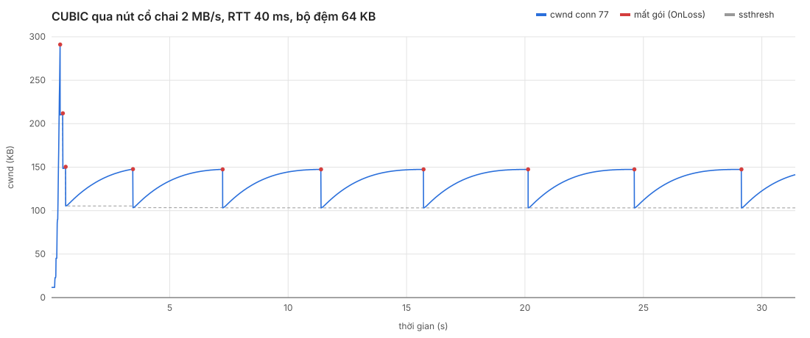
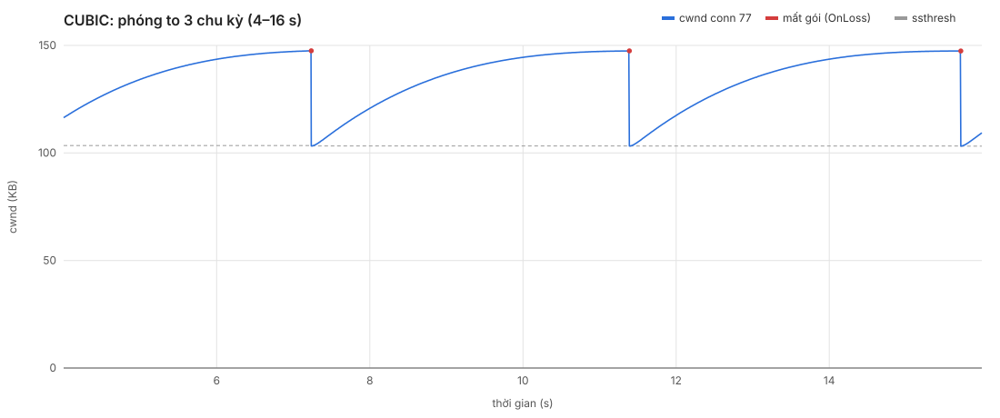

# Thiết kế reliability & congestion control (transport trên UDP)

Tài liệu này mô tả tầng `internal/transport`: cách biến UDP ("cố gắng gửi") thành kênh **tin cậy, đúng thứ tự trong từng stream, mã hóa, không Head-of-Line blocking, tự điều tốc**. Định dạng gói/frame xem `docs/protocol.md`.

## 1. Bốn vấn đề của UDP và cách giải quyết

| Vấn đề | Cơ chế | Code |
|---|---|---|
| Mất gói | Bên nhận ACK bằng SACK range; bên gửi phát hiện mất (số đếm / thời gian / RTO) và gửi lại **chỉ các frame của gói mất** | `ack.go`, `detectLoss`, `retransQ` |
| Sai thứ tự | Mỗi đoạn data mang `offset`; bên nhận ghép theo offset, **riêng từng stream** | `recvStream.push` |
| Lặp gói | Bỏ gói có `packet_num` đã thấy; bỏ đoạn có offset đã giao | `ackTracker.add`, `recvStream.push` |
| Gửi quá nhanh | Chỉ gửi khi `bytesInFlight + 1 gói ≤ min(cwnd, cửa sổ nhận)` | `flush`, `cubic.go` |
| HoL blocking | Mỗi tin/file là 1 stream ghép độc lập (phía nhận) + hàng đợi ưu tiên urgent/bulk (phía gửi) | `stream.go`, `takeFrames` |

**Mô hình concurrency:** mỗi `Conn` có đúng 1 goroutine `run()` sở hữu toàn bộ state (unacked, các hàng đợi, cwnd, stream...). Goroutine khác (app gọi `Write`, `Mux` đẩy gói vào) chỉ giao tiếp qua channel ⇒ phần phức tạp nhất không cần mutex, `go test -race` sạch.

## 2. Đường đi của dữ liệu

```
PHÍA GỬI
  SendMessage(b) / io.Copy(stream, file)
   └► SendStream.Write   cắt frame ≤ 1000 byte (copy), gắn stream_id + offset
       └► urgentCh / bulkCh   (bulkQ đầy 256 frame ⇒ Write bị chặn = backpressure)
           └► run() → flush()  còn cửa sổ? lấy frame theo thứ tự retransQ → urgentQ → bulkQ
               └► sendPacket   ghép ACK đang nợ + pn mới → AES-GCM → WriteToUDP; lưu unacked[pn]

PHÍA NHẬN
  readLoop (đọc conn_id ở header) → Conn.in → run().handlePacket
   ├─ giải mã (header là AAD) → ParseFrames → ackTracker.add(pn)
   ├─ AckFrame    → onAck: xóa khỏi unacked, đo RTT, cc.OnAck, detectLoss
   └─ StreamFrame → recvStream.push (ghép theo offset) → outQ → app.Recv()

ĐỒNG HỒ 10 ms: detectLoss · keepAlive (PING 2 s / timeout 10 s) · publishStats · cclog
```

`packet_num` đánh số **gói** (tăng mãi, kể cả khi gửi lại) dùng cho ACK và đo RTT; `offset` đánh số **byte trong stream** (cố định) dùng để ghép. Frame của gói #41 bị mất được đóng vào gói **#57** với offset giữ nguyên ⇒ đo RTT không bao giờ mập mờ (không cần thuật toán Karn như TCP).

## 3. ACK và phát hiện mất gói

- **ACK**: `[window][n][start,end]×n`, tối đa 8 range, quét lùi từ gói lớn nhất. Gửi ngay trong lần flush kế tiếp, đi kèm gói data nếu có (piggyback). Gói chỉ chứa ACK không được ACK lại (nếu không 2 bên ACK nhau vô hạn).
- **Ba cách kết luận gói đã mất** (RFC 9002):
  1. *Số đếm*: gói `pn` chưa ACK trong khi gói `≥ pn+3` đã ACK.
  2. *Thời gian*: đã có gói gửi sau nó được ACK, và nó đã quá `9/8 · RTT` ⇒ cần khi cwnd chỉ 2–3 gói (không bao giờ đủ 3 gói vượt mặt).
  3. *RTO*: không có ACK nào cả trong `SRTT + max(4·RTTVAR, 1 ms) + 10 ms`.
- **RTO backoff**: timeout liên tiếp ⇒ RTO ×2 (tối đa 5 s), có ACK mới ⇒ về bình thường. Khi mạng chết hẳn, không bắn gói dồn dập làm mạng tệ thêm.
- **Recovery period**: chỉ giảm cwnd **một lần** cho mỗi đợt mất (các gói gửi trước lần giảm gần nhất mất thêm thì bỏ qua).

**Vì sao không dùng RTO tối thiểu 200 ms như TCP?** TCP cần sàn lớn vì bên nhận được trì hoãn ACK tới 200–500 ms. Bên nhận của ta ACK ngay nên dùng công thức PTO của QUIC. Khi đo trên loopback với loss 10%, sàn 200 ms làm throughput giảm khoảng 6 lần (141 KB/s so với 826 KB/s), vì gần như mọi lần mất ở đuôi cửa sổ phải chờ trọn 200 ms trong khi RTT chỉ 0,4 ms. Ngược lại, khi bỏ hẳn khoảng đệm (`RTO = SRTT + 4·RTTVAR`) trên đường truyền rất đều thì RTTVAR tiến về 0, RTO ≈ RTT, và mỗi ACK về chậm một chút bị tính là mất oan. Trên nút cổ chai 2 MB/s, lỗi này kéo CUBIC xuống 0,87 MB/s; sau khi thêm khoảng đệm thì đạt 2,01 MB/s.

## 4. Không có Head-of-Line blocking: 2 tầng

1. **Phía nhận:** mỗi stream có `recvStream` riêng. Gói file bị mất chỉ làm *stream file* chờ; stream chat vẫn được giao ngay.
2. **Phía gửi:** `takeFrames` lấy frame theo thứ tự `retransQ → urgentQ → bulkQ`. Tin chat (urgent) chen lên trước hàng trăm frame file đang xếp hàng.

## 5. Congestion control: CUBIC (RFC 9438)

- **Slow start**: mỗi byte được ACK thì cwnd +1 byte ⇒ gấp đôi mỗi RTT.
- **Mất gói**: `wMax = cwnd; cwnd = 0.7·cwnd; ssthresh = cwnd`.
- **Tăng lại**: `W(t) = C·(t−K)³ + wMax`, `K = ∛(wMax·(1−β)/C)`, C = 0.4. Tăng nhanh khi còn xa wMax, chậm dần khi tới gần (mức từng gây nghẽn), đi ngang, rồi vượt qua để dò xem mạng có rộng hơn không. Tăng theo **thời gian thực** nên RTT dài vẫn hồi phục nhanh như RTT ngắn.
- **Vùng Reno-friendly**: song song tính `W_est` (Reno tăng 0.53 gói/RTT); `cwnd = max(W_cubic, W_est)`. RTT ngắn / cửa sổ nhỏ thì Reno tăng nhanh hơn đường bậc 3, CUBIC không được tệ hơn.
- **Sàn 2 gói, trần 1 MB** (= cửa sổ nhận; tăng thêm là vô nghĩa và tránh cwnd phình mãi khi chỉ chat).




Đồ thị trên: nút cổ chai 2 MB/s, trễ 20 ms mỗi chiều, bộ đệm 64 KB, không mất ngẫu nhiên. Mất gói luôn xảy ra ở **≈147 KB**, khớp với dung lượng đường truyền + bộ đệm (BDP 2 MB/s × 42 ms ≈ 84 KB + 64 KB). Sau mỗi lần mất, cwnd tụt còn ≈ 70% rồi cong lên theo hình chữ S nằm ngang, chu kỳ ≈ 4 s, khớp với K ≈ ∛(122·0.3/0.4) ≈ 4.5 s.

**Giới hạn đã biết:** CUBIC (như mọi thuật toán dựa trên mất gói) không phân biệt "mất do nghẽn" với "mất ngẫu nhiên" (sóng yếu). Với `-loss 0.1` cwnd nằm sát đáy ⇒ chậm. Công thức Mathis: throughput ≈ (MSS/RTT)·1.22/√p. Đây là động lực của BBR (đo băng thông + RTT thay vì dựa vào mất gói). Vì vậy giữ thêm `-cc fixed` để demo độ tin cậy khi giả lập mất gói nặng.

## 6. Giả lập mạng: `LossyConn`

| Trường | Ý nghĩa |
|---|---|
| `Loss` | bỏ gói ngẫu nhiên (không phải nghẽn) |
| `Delay`, `Jitter` | trễ đường truyền; **FIFO** như hàng đợi router (gói sau không bao giờ tới trước gói trước) |
| `Reorder` | cố ý cho mỗi gói trễ độc lập ⇒ đảo thứ tự hàng loạt |
| `Rate`, `QueueBytes` | nút cổ chai băng thông + bộ đệm; đầy thì tail drop ⇒ mất gói **do nghẽn** |

Bản đầu hẹn giờ từng gói độc lập ⇒ với jitter 20 ms, gói bị đảo thứ tự hàng loạt và **89% gói bị coi là mất oan dù loss = 0** (luật "3 gói vượt mặt" giả định mạng gần như giữ thứ tự). Sau khi chuyển sang FIFO: 0.1%.

## 7. Số đo

Máy đo: WSL2, loopback, Go 1.27. Lệnh: `BTL_LONG=1 go test -run Long -v -timeout 30m ./internal/transport/`.

| Kịch bản | CC | Kết quả |
|---|---|---|
| 5 MB, loss 20% mỗi chiều (test Phase 2) | fixed | 0.12–0.14 s, dữ liệu đúng từng byte |
| 1 MB, loss 10% | cubic | ≈ 0.5–1 s |
| 50 MB, loss 10%, jitter 20 ms | fixed | 30.6 s, 1.71 MB/s, gửi lại 9.9% |
| 5 MB, loss 10%, jitter 20 ms | cubic | 46.9 s, 0.11 MB/s (đúng dự đoán Mathis) |
| 20 MB, loss 0%, jitter 20 ms | cubic | 1.3 s, 15.7 MB/s, gửi lại 0.1% |
| 60 MB qua nút cổ chai 2 MB/s, RTT 40 ms | cubic | **2.01 MB/s (dùng hết link)** |
| 20 MB qua nút cổ chai 2 MB/s, RTT 40 ms | fixed 64 KB | 1.47 MB/s (64 KB < BDP + bộ đệm) |

**Head-of-Line blocking** (file 6 MB qua nút cổ chai 1 MB/s, trễ 20 ms mỗi chiều, loss 1%, chat mỗi 100 ms):

| Chat đi bằng | Trung bình | p50 | p95 | max |
|---|---|---|---|---|
| Không có file (mốc) | 23.6 ms | 20.8 ms | 21.6 ms | 77.1 ms |
| **Hàng đợi urgent** (thiết kế hiện tại) | **31.1 ms** | 28.5 ms | 48.7 ms | 55.3 ms |
| Chung hàng bulk với file (giả lập không ưu tiên) | 763 ms | 738 ms | 1091 ms | 1152 ms |

⇒ Khi đang gửi file, chat chỉ chậm thêm vài ms so với lúc rảnh; nếu không có hàng đợi ưu tiên thì chậm gấp ~25 lần.

## 8. Test

`go test -race ./...` (vài chục giây) gồm: round-trip mọi loại frame và header, dữ liệu cụt/type lạ ⇒ lỗi (không panic); ECDH 2 bên ra cùng khóa; **sửa bất kỳ byte nào của gói ⇒ giải mã thất bại**; nonce khác nhau theo chiều; SACK range; RTT/RTO; ghép stream (đảo, trùng, chồng lấn, FIN tới trước); CUBIC (slow start, giảm 30%, hình dạng đường bậc 3, vùng Reno-friendly, sàn/trần); **5 MB qua loss 20%**; chiều server→client; **không thấy plaintext trên dây**; `Close`/`Mux.Close` báo đầu kia ngay; client chết ⇒ server phát hiện sau ~10 s; RTO backoff; gửi lại đúng thứ tự pn; ACK cũ không ghi đè cửa sổ; `LossyConn` FIFO và nút cổ chai.
