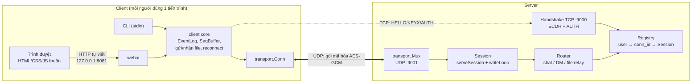
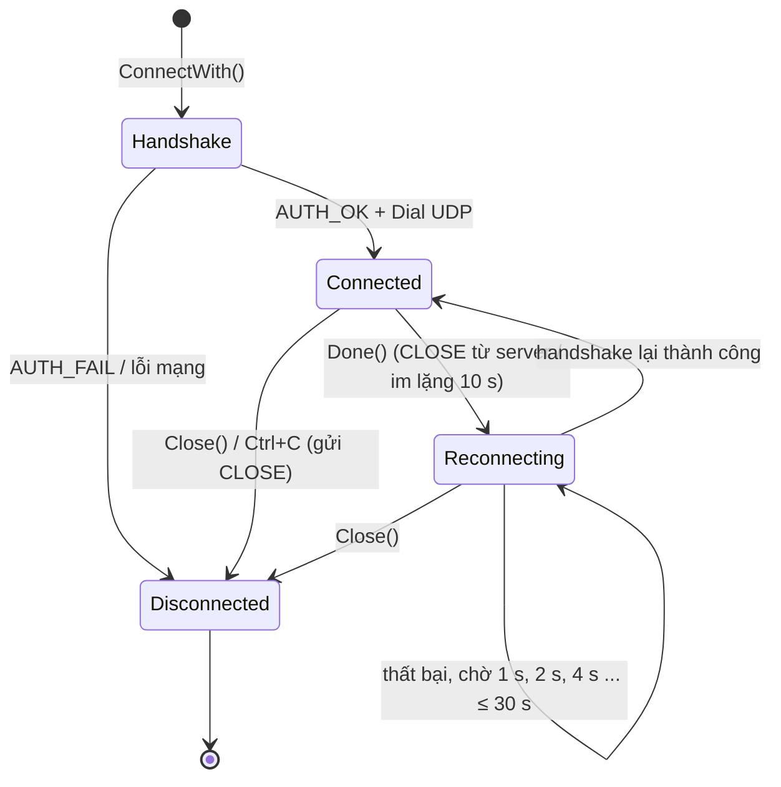
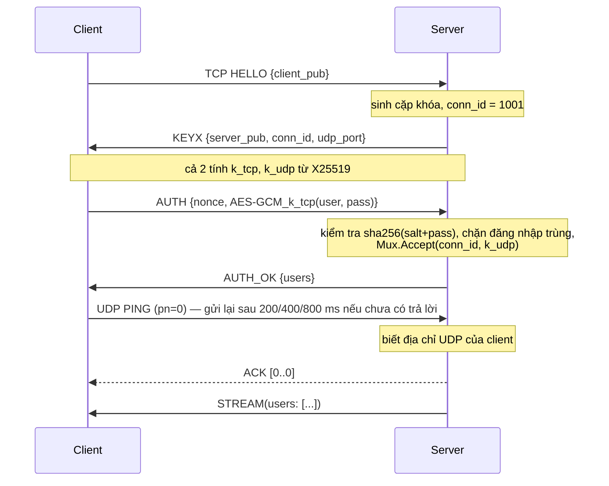
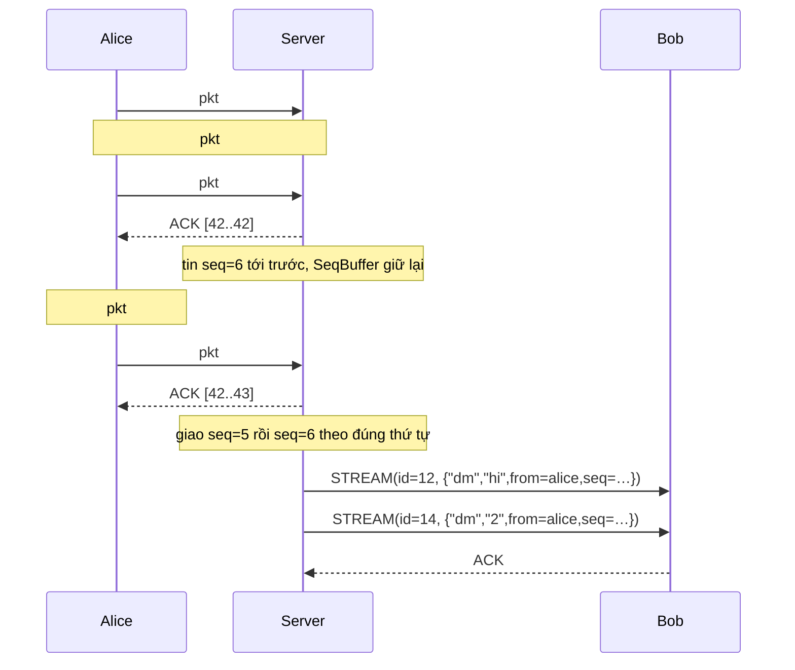
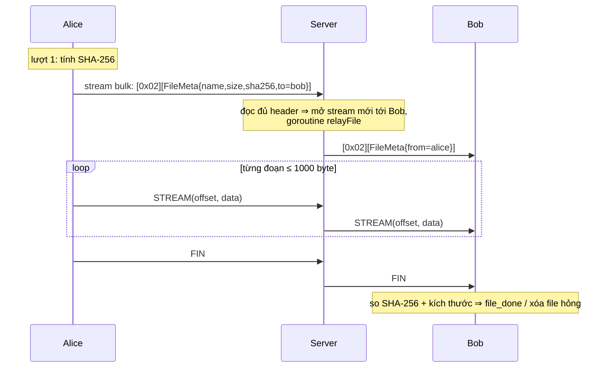
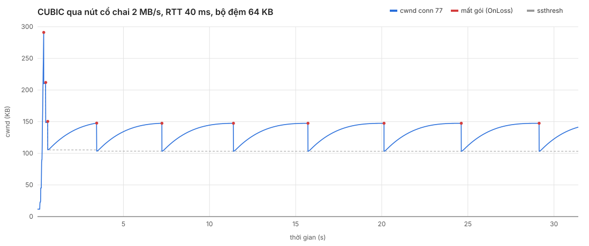

# Báo cáo BTL1 — Ứng dụng cộng tác client–server trên giao thức tin cậy tự viết (Go)

> **Bản nháp.** Các mục do máy sinh từ code và số đo thật. Nhóm cần: điền tên/MSSV, chèn ảnh Wireshark (mục 8),
> vẽ lại sơ đồ Mermaid thành ảnh (dán vào [mermaid.live](https://mermaid.live)), đọc lại văn phong, rồi xuất PDF.

| Thành viên | MSSV | Phụ trách |
|---|---|---|
| A — … | … | `internal/protocol` (gói, frame), `internal/transport` (reliability, mã hóa, CUBIC), tài liệu giao thức |
| B — … | … | `internal/server` (handshake, auth, định tuyến, chuyển tiếp file), `internal/client`, `internal/webui` |

---

## 1. Tổng quan

Ứng dụng cho phép nhiều người dùng đăng nhập vào 1 server để **chat chung, nhắn riêng (DM) và gửi file**. Toàn bộ
dữ liệu đi qua **một giao thức tin cậy tự viết trên UDP**; TCP chỉ dùng cho bước handshake (trao đổi khóa +
đăng nhập). Chỉ dùng thư viện chuẩn của Go (socket thô `net`, `crypto/*`); HTTP server của Web UI cũng tự viết
trên socket TCP.

| Step | Yêu cầu | Cách đáp ứng | Bằng chứng |
|---|---|---|---|
| 1 | Thiết kế giao thức | Gói UDP ≤ 1200 byte, 4 loại frame, stream ghép kênh | `docs/protocol.md`, mục 3 |
| 2 | Handshake TCP | `HELLO → KEYX → AUTH → AUTH_OK/FAIL`, khung `[len][JSON]` | `internal/server/auth.go`, mục 4.1 |
| 3 | Auth + quản lý trạng thái | `users.json` (salt + SHA-256), registry theo user và conn_id, chặn đăng nhập trùng | `TestAuthFail` |
| 4 | Concurrency | goroutine mỗi kết nối TCP / mỗi session / mỗi Conn transport | `TestManyClientsNoLeak`, `scripts/load_test.sh` |
| 5 | Streaming nhạy thời gian | Mỗi tin = 1 stream ưu tiên cao; không HoL | mục 6.3, `TestChatLatencyDuringFile` |
| 6 | Truyền file tin cậy qua UDP | SACK + gửi lại + SHA-256 đầu cuối | `TestFileTransfer` |
| 7 | Resilience | Idle timeout 10 s, CLOSE khi thoát, client tự kết nối lại, bỏ gói rác, `recover` | `TestClientKilled`, `TestServerRestartReconnect`, `TestGarbageUDP` |
| 8 | Bảo mật | ECDH X25519 + AES-256-GCM (header là AAD), mật khẩu gửi đã mã hóa | mục 7, ảnh Wireshark |
| 9 | HTTP UI + JS thuần | HTTP/1.1 tự viết, polling `/api/events`, thanh tiến trình, danh sách user, trạng thái mạng | `internal/webui` |
| 10 | Test & chất lượng | `go vet`, `go test -race` sạch, e2e 9 kịch bản | mục 8 |

---

## 2. Kiến trúc hệ thống



Ba tầng:

1. **Tầng mạng** (`internal/transport`, `internal/protocol`): biến UDP thành kênh tin cậy, mã hóa, ghép nhiều
   stream độc lập trên 1 kết nối, tự điều tốc (CUBIC). Server dùng **1 socket UDP** cho mọi client; `Mux` đọc
   `conn_id` trong header để chuyển gói tới đúng `Conn`.
2. **Tầng xử lý** (`internal/server`, `internal/client`): xác thực, quản lý phiên, định tuyến chat/DM, chuyển tiếp
   file dạng luồng (không lưu cả file trong RAM), sắp xếp tin theo `Seq`, kết nối lại.
3. **Tầng giao diện** (`internal/webui`, CLI): HTTP server tự viết phục vụ trang tĩnh và API JSON; trình duyệt
   hỏi `/api/events?since=N` định kỳ để lấy sự kiện mới.

**Mô hình concurrency.**

| Goroutine | Số lượng | Việc |
|---|---|---|
| `handleHandshake` | 1 / kết nối TCP | handshake, có deadline 10 s chống treo |
| `Mux.readLoop` | 1 / server | đọc socket UDP, chuyển gói theo `conn_id` |
| `Conn.run` | 1 / kết nối | **sở hữu toàn bộ state transport** (unacked, hàng đợi, cwnd); giao tiếp qua channel nên không cần mutex |
| `serveSession` | 1 / user | đọc stream đến, định tuyến tin, mở relay file |
| `writeLoop` | 1 / user | gửi tin ra theo thứ tự, đánh `Seq` |
| `relayFile` | 1 / file đang chuyển | đọc từ channel, ghi tới các người nhận |

Một client chậm không làm chậm người khác: `Session.Send` không chặn (hàng đợi 4096 tin); đầy thì server ngắt
client đó thay vì bỏ tin âm thầm.

---

## 3. Đặc tả giao thức

Bản đầy đủ: `docs/protocol.md`. Tóm tắt:

### 3.1 Cổng

| Cổng | Giao thức | Dùng cho |
|---|---|---|
| 9000 | TCP | handshake: trao đổi khóa, đăng nhập |
| 9001 | UDP | mọi dữ liệu (chat, DM, file, ACK, PING) |
| 9002 | UDP broadcast | server quảng bá địa chỉ trong LAN |

### 3.2 Handshake TCP

Mỗi message: `[4 byte độ dài, big-endian][JSON]`.

| # | Hướng | Message | Nội dung |
|---|---|---|---|
| 1 | C → S | `HELLO` | khóa công khai X25519 của client |
| 2 | S → C | `KEYX` | khóa công khai X25519 của server, `conn_id`, cổng UDP |
| 3 | C → S | `AUTH` | `{user, pass}` **mã hóa AES-GCM bằng `k_tcp`** |
| 4 | S → C | `AUTH_OK` / `AUTH_FAIL` | danh sách user online / lý do |

Hai bên tính `shared = X25519(priv, peerPub)`, rồi `k_tcp = SHA-256(shared ‖ "tcp")`, `k_udp = SHA-256(shared ‖ "udp")`.

### 3.3 Gói UDP

```
 0      2   3   4          8              12
 +------+---+---+----------+---------------+------------------------------------+
 | 0xC0DE|ver|flg| conn_id  |  packet_num   |  frames (mã hóa AES-256-GCM) + tag |
 +------+---+---+----------+---------------+------------------------------------+
  header 12 byte gửi rõ = AAD                     ≤ 1200 byte cả gói
```

- Gói ≤ 1200 byte để không bị phân mảnh IP (MTU 1280 của IPv6 trừ header).
- Nonce GCM 12 byte = `conn_id ‖ packet_num ‖ chiều` ⇒ không bao giờ lặp (packet_num tăng mãi kể cả khi gửi lại;
  2 chiều dùng chung khóa nhưng khác byte chiều).
- Header là AAD: sửa bất kỳ byte nào (kể cả `conn_id`) ⇒ giải mã thất bại ⇒ gói bị bỏ.

### 3.4 Frame

| Frame | Trường | Ý nghĩa |
|---|---|---|
| `STREAM` | stream_id, offset, FIN, data ≤ 1000 byte | 1 đoạn dữ liệu của 1 stream |
| `ACK` | cửa sổ nhận, tối đa 8 range `[start,end]` | SACK theo packet_num + flow control |
| `PING` | — | giữ kết nối / đo RTT / để server biết địa chỉ client |
| `CLOSE` | lý do | đóng ngay, không cần đợi timeout |

### 3.5 Tầng app

Byte đầu của stream cho biết loại: `0x01` MESSAGE (`[0x01][JSON AppMsg]`) hoặc `0x02` FILE
(`[0x02][len][JSON FileMeta][bytes]`). Meta đi chung stream với dữ liệu vì giữa các stream không có thứ tự.

`AppMsg.Seq` đánh số tin theo từng kết nối; bên nhận dùng `SeqBuffer` sắp lại để giao **đúng thứ tự gửi**
mà tầng transport vẫn không có HoL giữa các tin (xem mục 9, thử thách 1).

### 3.6 State diagram của client



---

## 4. Sequence diagram

### 4.1 Đăng nhập



### 4.2 Một tin DM bị mất gói và được gửi lại



### 4.3 Gửi file qua server



---

## 5. Đảm bảo tin cậy

Chi tiết: `docs/reliability.md`.

| Vấn đề của UDP | Cơ chế |
|---|---|
| Mất gói | SACK (8 range); phát hiện mất theo **số đếm** (bị 3 gói vượt mặt), **thời gian** (bị vượt mặt và quá 9/8 RTT), **RTO** (`SRTT + max(4·RTTVAR, 1 ms) + 10 ms`, backoff ×2 ≤ 5 s); chỉ gửi lại frame của gói mất, với packet_num mới (đo RTT không mập mờ) |
| Sai thứ tự | Ghép theo offset, riêng từng stream; tin nhắn sắp lại theo `Seq` |
| Lặp gói | Bỏ packet_num đã thấy, bỏ đoạn có offset đã giao, bỏ `Seq` đã giao |
| Gửi quá nhanh | Chỉ gửi khi `bytesInFlight + 1 gói ≤ min(cwnd, cửa sổ nhận 1 MB)`; hàng đợi bulk đầy ⇒ `Write` bị chặn (backpressure) |
| Gói rác / giả mạo | Sai magic/version/conn_id hoặc giải mã GCM thất bại ⇒ bỏ im lặng |
| Bên kia chết | PING mỗi 2 s khi rảnh; im lặng 10 s ⇒ đóng kết nối |

---

## 6. Congestion control và Head-of-Line blocking

### 6.1 CUBIC (RFC 9438)

Slow start gấp đôi mỗi RTT; mất gói ⇒ `wMax = cwnd`, `cwnd = 0.7·cwnd`; tăng lại theo
`W(t) = C·(t−K)³ + wMax` (C = 0.4), có vùng Reno-friendly; sàn 2 gói, trần 1 MB. Mỗi đợt mất chỉ giảm 1 lần.



Nút cổ chai 2 MB/s, trễ 20 ms mỗi chiều, bộ đệm 64 KB: mất gói luôn xảy ra ở ≈147 KB = BDP (≈84 KB) + bộ đệm
(64 KB); sau mỗi lần mất cwnd còn ≈70% rồi cong lên theo hình chữ S nằm ngang, chu kỳ ≈4 s (lý thuyết K ≈ 4.5 s).
CUBIC đạt 2.01 MB/s (dùng hết link), cửa sổ cố định 64 KB chỉ đạt 1.47 MB/s.

### 6.2 Giới hạn

CUBIC coi mọi lần mất là nghẽn. Với mất ngẫu nhiên 10% (`-loss 0.1`) cwnd nằm sát đáy ⇒ chậm, đúng như công thức
Mathis (throughput ∝ 1/√p). Vì vậy giữ `-cc fixed` để demo độ tin cậy dưới mất gói nặng; hướng giải quyết thật là
BBR (đo băng thông + RTT thay vì dựa vào mất gói).

### 6.3 Không Head-of-Line blocking

1. **Phía nhận:** mỗi stream ghép riêng ⇒ gói file mất chỉ làm stream file chờ.
2. **Phía gửi:** lấy frame theo thứ tự `gửi lại → urgent (chat) → bulk (file)` ⇒ tin chat chen lên trước hàng
   trăm frame file đang xếp hàng.

| Chat đi bằng (file 6 MB, nút cổ chai 1 MB/s, trễ 20 ms, loss 1%) | p50 | p95 | max |
|---|---|---|---|
| Không có file (mốc) | 20.8 ms | 21.6 ms | 77.1 ms |
| **Hàng urgent** (thiết kế hiện tại) | **28.5 ms** | **48.7 ms** | 55.3 ms |
| Chung hàng với file (giả lập không ưu tiên) | 738 ms | 1091 ms | 1152 ms |

---

## 7. Bảo mật

- **Trao đổi khóa:** ECDH X25519 (khóa tạm mỗi phiên ⇒ forward secrecy). Mật khẩu chỉ đi trên dây sau khi đã mã
  hóa bằng `k_tcp`.
- **Mã hóa dữ liệu:** AES-256-GCM cho mọi gói UDP; header là AAD nên không sửa được `conn_id`/`packet_num`;
  nonce không bao giờ lặp. Test `TestWireIsEncrypted` xác nhận không thấy plaintext trên dây.
- **Lưu mật khẩu:** `sha256(salt + password)`.
- **Chống giả danh trong app:** server ghi đè trường `From` bằng user của phiên.
- **Giới hạn đã biết:** server không có chứng chỉ ⇒ ECDH chưa xác thực server, về lý thuyết có thể bị
  man-in-the-middle khi kẻ tấn công chen được vào đường truyền ngay lúc handshake (khắc phục: ký `server_pub` bằng
  khóa dài hạn mà client biết trước, giống TLS). SHA-256 một lượt cho mật khẩu nhanh hơn mức nên dùng
  (nên dùng bcrypt/argon2, không có trong thư viện chuẩn).

*(Chèn ảnh Wireshark: `tcp.port == 9000 || udp.port == 9001`; chỉ ra (1) AUTH chỉ thấy chuỗi base64 của `sealed`,
không thấy mật khẩu; (2) payload UDP không đọc được tin chat.)*

---

## 8. Kết quả test

Môi trường: WSL2 (Linux 6.18), Go 1.27.3, loopback. `go vet ./...` và `go test -race ./...` sạch.
Kịch bản 1–9 tự động trong `internal/e2e` (server + client thật); số liệu dưới đây lấy từ
`BTL_LONG=1 go test -v ./internal/e2e/` và `scripts/load_test.sh 20 300`. Chi tiết: `docs/test-results.md`.

| # | Kịch bản | Kết quả |
|---|---|---|
| 1 | 3 client, chat chung + DM | ✅ 200 chat + 200 DM: đúng người nhận, đúng thứ tự, không trùng |
| 2 | Loss 10%, 20%, loss 10% + jitter 30 ms | ✅ đủ 200/200 tin, đúng thứ tự, không trùng |
| 3 | File 1 KB / 10 MB / 200 MB, loss 0% và 10% | ✅ SHA-256 khớp mọi trường hợp (bảng dưới) |
| 4 | Gửi file 200 MB + chat cùng lúc | ✅ độ trễ chat p50 32 ms, p95 174 ms (< 300 ms) |
| 5 | Ctrl+C / `kill -9` 1 client | ✅ server báo rời đi sau 20 ms / 10 s, không crash |
| 6 | Tắt server rồi bật lại | ✅ client tự kết nối lại sau ≈1 s |
| 7 | Sai mật khẩu / user lạ / đăng nhập trùng | ✅ `AUTH_FAIL` kèm lý do |
| 8 | 5000 gói rác vào cổng UDP | ✅ bị bỏ qua, client không bị ngắt |
| 9 | 20 bot × 5 phút | ✅ goroutine 86 ổn định ⇒ 6 khi thoát; CPU 3.1%; không mất tin |
| 10 | Wireshark | (chèn ảnh) — payload và mật khẩu không đọc được |

| File | Loss | Thời gian | Throughput |
|---|---|---|---|
| 10 MB | 0% | 0.27 s | 37.5 MB/s |
| 10 MB | 10% | 10.7 s | 0.94 MB/s |
| 200 MB | 0% | 5.4 s | 36.9 MB/s |
| 200 MB | 10% | 3 phút 13 s | 1.03 MB/s |

Với mất ngẫu nhiên 10% CUBIC giữ cwnd nhỏ (mục 6.2); `-cc fixed` truyền 50 MB ở loss 10% + jitter 20 ms đạt 1.69 MB/s.

---

## 9. Thử thách & cách giải quyết

1. **Tin chat bị đảo thứ tự và bị mất dù không mất gói.** Mỗi tin là 1 stream riêng (để không HoL), nên stream nào
   xong trước được giao trước. Đồng thời hàng đợi gửi 64 tin của server âm thầm bỏ tin khi 1 người gửi nhanh
   (400 tin liên tiếp ⇒ mất 85 tin, không hề mất gói). *Giải pháp:* `Seq` + `SeqBuffer` ở tầng app; hàng đợi 4096
   tin, đầy thì ngắt client quá chậm thay vì bỏ tin.
2. **Client mới "điếc" 2–4 giây khi mạng mất gói.** Server chỉ biết địa chỉ UDP của client khi nhận được gói đầu
   tiên; nếu PING đầu bị mất thì phải chờ PING keep-alive 2 s sau. *Giải pháp:* gửi lại PING đầu sau 200, 400,
   800 ms... cho tới khi nghe được server (giống QUIC gửi lại gói Initial). File 1 KB ở loss 10%: 2–4 s ⇒ ≤ 0.6 s.
3. **Server tốn 43% CPU khi 20 client không làm gì.** Mỗi kết nối tick 10 ms kể cả khi rảnh ⇒ Go scheduler thức
   4000 lần/s (profile: `futex`, `findRunnable`). *Giải pháp:* tick 10 ms khi có gói chờ ACK, 100 ms khi rảnh
   (keep-alive 2 s và timeout 10 s không cần chính xác tới 10 ms). CPU khi rảnh giảm ~10 lần, throughput không đổi.
4. **Danh sách người online sai khi nhiều người đăng nhập cùng lúc.** Đọc danh sách và xếp tin là 2 bước; 2 broadcast
   xen kẽ có thể gửi bản cũ sau bản mới. *Giải pháp:* mutex bao cả 2 bước. Lỗi chỉ lộ ra khi stress test (3/20 lần).
5. **CUBIC làm transport chậm 280 lần ở loss 10%.** cwnd nằm ở sàn 2 gói ⇒ không bao giờ đủ "3 gói vượt mặt" ⇒
   mọi lần mất phải chờ RTO 200 ms (RTT chỉ 0.4 ms). *Giải pháp:* thêm phát hiện mất theo thời gian và RTO kiểu
   QUIC (bên nhận không trì hoãn ACK nên không cần sàn 200 ms của TCP).
6. **Mất gói "oan" 89% dù loss = 0.** Bộ giả lập jitter hẹn giờ từng gói độc lập ⇒ đảo thứ tự hàng loạt ⇒ luật
   "3 gói vượt mặt" kết luận sai. *Giải pháp:* giả lập jitter bằng hàng đợi FIFO như router thật.
7. **Code CUBIC mẫu ra đường thẳng kiểu Reno.** Nhánh tăng 1 gói/RTT lấn át đường bậc 3 khi RTT ngắn. *Giải pháp:*
   viết lại theo RFC 9438 (W_cubic và W_est song song).
8. **`select` với channel có buffer:** ghi vào stream sau khi đóng vẫn "thành công" vì Go chọn ngẫu nhiên giữa các
   nhánh sẵn sàng. *Giải pháp:* kiểm tra `done` trước.
9. **Trùng nonce GCM giữa 2 chiều** (cùng khóa, cùng packet_num): thêm byte chiều vào nonce.
10. **Mơ hồ RTT khi gửi lại:** mỗi lần gửi lại dùng packet_num mới (không cần thuật toán Karn).
11. **ACK vô hạn:** gói chỉ chứa ACK thì không ACK lại.
12. **IP fragmentation:** giới hạn gói ≤ 1200 byte.
13. **Data race** giữa goroutine nhận và tầng app: phát hiện bằng `go test -race`; thiết kế 1 goroutine sở hữu
    state transport, giao tiếp qua channel.

---

## 10. Hướng phát triển

- Xác thực server (ký khóa ECDH) để chống MITM; băm mật khẩu bằng hàm chậm.
- Congestion control dựa trên mô hình (BBR) để không giảm tốc vì mất gói ngẫu nhiên.
- Gửi file trực tiếp giữa 2 client (P2P, UDP hole punching) để giảm tải server.
- Đẩy sự kiện tới trình duyệt bằng long-polling / Server-Sent Events thay cho polling.
